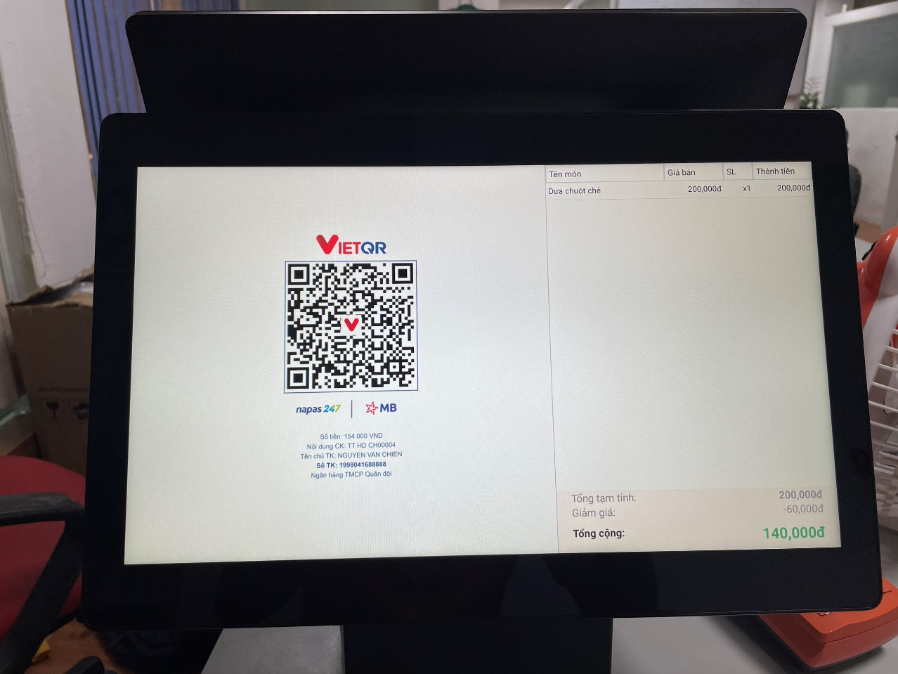

# Thêm QR code ngân hàng động

**THÊM QR CHUYỂN KHOẢN CUỐI HÓA ĐƠN**\
_(QR chuyển khoản trực tiếp vào stk đã set link theo số tiền đơn hàng)_

**Nếu bạn đang muốn mẫu in có QR chuyển khoản của các ngân hàng như này ta làm như sau:**

 

<figure><figcaption></figcaption></figure>

**\_\_\_\_\_\_\_\_\_\_\_\_\_\_\_\_\_\_\_\_**

**Bước 1: Cài đặt Ngân hàng trên web**\
Tại trang quản trị > Quản lý thu chi > danh mục quỹ > chọn chỉnh sửa quỹ chuyển khoản

.png>)

Chọn loại " TK Ngân hàng mặc định" > tích chọn Thiết lập VietQr

.png>)

Lựac chọn ngân hàng muốn tạo QR > điền thông tin tên TK, số tk > lưu lại\
(logo và phần hiển thị thêm bên dưới không quan trọng)

.png>)

**>> Như vậy là hoàn thành mình lên máy Pos để đồng bộ lại**\
**Bước 2: Đồng bộ và sử dụng trên máy Pos**

Trên máy bán hàng tiến hành đồng bộ lại app 

<figure><figcaption></figcaption></figure>

Order và bán hàng bình thường tới bước thanh toán > chọn quỹ chuyển khoản mà ta đã cài đặt ở bước 1

<figure><figcaption></figcaption></figure>

Nếu máy Pos có 2 màn thì màn phụ sẽ hiển thị mã QR cho khách quét ở màn sau

Hoặc máy không có màn hình phụ để hiển thị thì mẫu in ra sẽ có mã QR trên mẫu in

.png>)

**>> Chúc các bạn thành công**
