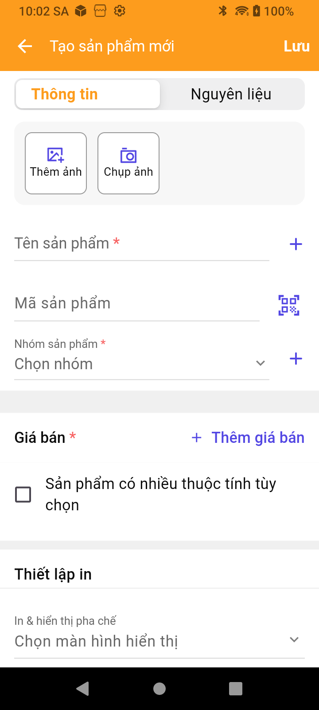
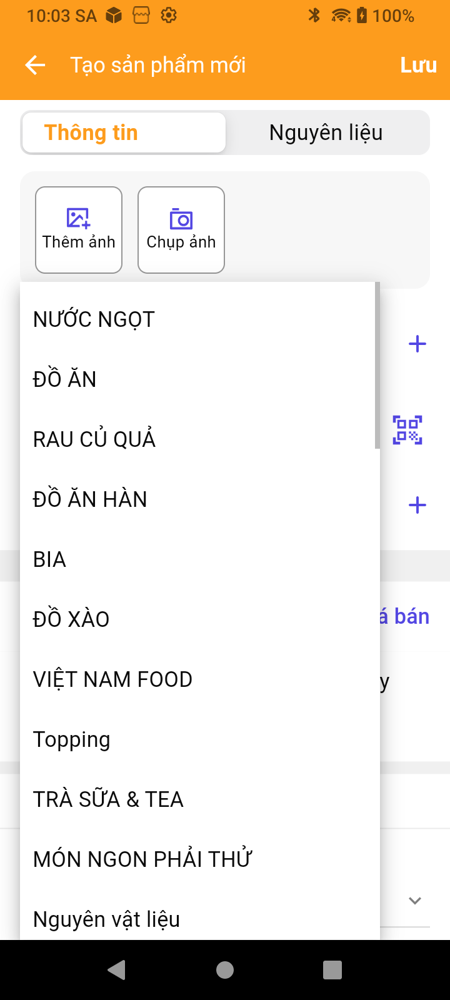

# Thêm sản phẩm, dịch vụ trên ứng dụng PosApp

Hướng dẫn tạo sản phẩm hoặc dịch vụ có giá cố định bằng chức năng **Tạo sản phẩm chi tiết** trên PosApp FnB.

Ảnh chụp trực tiếp trên máy V3, PosApp **26.10.0**, ngày **20/10/2026**. Tên nhóm, bố cục và chức năng có thể khác theo cửa hàng, thiết bị và quyền tài khoản.

## Chuẩn bị

- Đăng nhập đúng cửa hàng bằng tài khoản có quyền quản lý sản phẩm.
- Chuẩn bị tên, nhóm, đơn vị tính và giá bán.
- Chuẩn bị mã sản phẩm và ảnh nếu cần.

| Thông tin | Ví dụ sản phẩm | Ví dụ dịch vụ có giá cố định |
| --- | --- | --- |
| Tên | Trà đào | Dịch vụ giao hàng |
| Nhóm | Nhóm đồ uống của cửa hàng | Nhóm dịch vụ của cửa hàng |
| Đơn vị bán | Ly | Lần |
| Giá bán | 30.000 đồng | 20.000 đồng |

Thông tin trên chỉ để minh họa, chưa được tạo trên máy.

## Bước 1. Mở danh mục sản phẩm

Từ **Trang chủ**, chọn ô **Sản phẩm**. Nếu ô nằm bên dưới màn hình, cuộn xuống để nhìn thấy.

Ứng dụng mở **Danh mục sản phẩm**. Các thẻ phía trên dùng để xem sản phẩm theo nhóm.

<figure><figcaption>
Bấm dấu + màu cam để bắt đầu thêm sản phẩm.
</figcaption></figure>

## Bước 2. Chọn tạo sản phẩm chi tiết

Bấm dấu **+** màu cam ở góc dưới bên phải, sau đó chọn **Tạo sản phẩm chi tiết**.

<figure><figcaption>
Chọn Tạo sản phẩm chi tiết để mở biểu mẫu đầy đủ.
</figcaption></figure>

Menu còn có các lựa chọn tạo nhanh, quét mã, quét thực đơn và tạo sản phẩm tiền giờ. Bài này hướng dẫn luồng tạo chi tiết; dịch vụ tính theo thời gian cần hướng dẫn riêng.

## Bước 3. Nhập thông tin sản phẩm hoặc dịch vụ

Tại **Tạo sản phẩm mới**, ở thẻ **Thông tin**:

1. Nhập **Tên sản phẩm**.
2. Nhập **Mã sản phẩm** nếu cửa hàng sử dụng mã.
3. Chọn **Nhóm sản phẩm** phù hợp.
4. Nếu cần ảnh, bấm **Thêm ảnh** để lấy ảnh có sẵn hoặc **Chụp ảnh** để chụp bằng thiết bị.

Các mục có dấu **\*** là thông tin bắt buộc trên biểu mẫu.

<figure><figcaption>
Nhập tên, chọn nhóm và bổ sung ảnh nếu cần.
</figcaption></figure>

## Bước 4. Chọn nhóm sản phẩm

Bấm **Chọn nhóm**, rồi chọn nhóm từ danh sách của cửa hàng. Chẳng hạn, chọn nhóm đồ uống cho món nước, hoặc nhóm dịch vụ phù hợp cho dịch vụ có giá cố định.

<figure><figcaption>
Nhóm trong ảnh thuộc cửa hàng minh họa; mỗi cửa hàng có thể có danh sách khác nhau.
</figcaption></figure>

## Bước 5. Thiết lập đơn vị và giá bán

Trên biểu mẫu sản phẩm, bấm **+ Thêm giá bán**.

1. Tại **Đơn vị bán**, chọn đơn vị tính phù hợp, chẳng hạn Ly hoặc Lần nếu cửa hàng đã có các đơn vị này.
2. Nhập **Giá bán**.
3. Kiểm tra **Giá trị quy đổi so với đơn vị cơ bản**. Giá trị ban đầu trên biểu mẫu là **1**; thay đổi nếu đơn vị bán có quy đổi khác.
4. Bổ sung **Giá vốn**, **Giá nhập**, **Mã vạch**, **Giá so sánh kênh online** khi cần.
5. Kiểm tra **Mặc định bán hàng** và **Mặc định hiển thị tồn kho**.
6. Bấm **Xác nhận** để đưa thông tin giá về biểu mẫu sản phẩm. Bấm **Hủy bỏ** nếu không muốn áp dụng phần giá đang nhập.

<figure><figcaption>
Chọn đơn vị và nhập giá, rồi bấm Xác nhận.
</figcaption></figure>

## Bước 6. Kiểm tra thiết lập bổ sung

Cuộn xuống phần dưới của biểu mẫu:

- **Sản phẩm có nhiều thuộc tính tùy chọn**: dùng khi cần cấu hình nhiều thuộc tính; xem [hướng dẫn thuộc tính tùy chọn](../san-pham-co-nhieu-thuoc-tinh-tuy-chon.md).
- **Thiết lập in → In & hiển thị pha chế**: chọn cấu hình phù hợp nếu sản phẩm cần chuyển đến màn hình pha chế.
- **Quản lý kho**: kiểm tra có cần theo dõi kho hay không. Với dịch vụ không theo dõi số lượng tồn, để lựa chọn này không được tích.
- **Mô tả sản phẩm tại đây**: nhập mô tả nếu cần.
- **Bật tắt sử dụng sản phẩm**: kiểm tra trạng thái phù hợp trước khi lưu.

<figure><figcaption>
Kiểm tra các thiết lập phù hợp với sản phẩm hoặc dịch vụ của cửa hàng.
</figcaption></figure>

## Bước 7. Lưu và kiểm tra

1. Kiểm tra tên, nhóm, đơn vị tính và giá bán.
2. Bấm **Lưu** ở góc trên bên phải màn hình **Tạo sản phẩm mới**.
3. Khi ứng dụng báo thành công, quay lại **Danh mục sản phẩm**, dùng biểu tượng tìm kiếm để tìm đúng tên hoặc mã vừa tạo.
4. Mở lại sản phẩm và đối chiếu thông tin đã nhập.

Nếu ứng dụng yêu cầu bổ sung dữ liệu, kiểm tra trước các mục có dấu **\***: tên, nhóm sản phẩm và thông tin giá bán.


Ảnh trong bài ghi lại các màn hình trước khi lưu. Chưa có ảnh xác nhận tạo thành công; cần bổ sung khi thực hiện với dữ liệu mẫu được cửa hàng cho phép.


## Video tham khảo

Video đã có trong tài liệu trước đây:


