# Thêm sản phẩm trên ứng dụng PosApp FnB

## I. Khi nào sử dụng hướng dẫn này?

Bạn có món mới cần đưa vào danh mục bán hàng, chẳng hạn **Matcha Latte**, nhưng chưa có nhóm đồ uống hoặc đơn vị tính phù hợp. Bài viết hướng dẫn từ lúc mở danh mục đến khi tạo thành công và tìm lại sản phẩm.

**Ví dụ thực hành:** tạo **Matcha Latte Demo**, mã **HD-MATCHA-01**, thuộc nhóm **MENU DEMO**, đơn vị **Ly Demo**, giá **35.000 đồng**. Đây là dữ liệu mẫu đã được lưu và mở lại để kiểm tra trên PosApp **26.10.0**, thiết bị V3 ngày **20/10/2026**.

Khi thao tác tại cửa hàng của bạn, thay các tên có chữ **Demo** bằng tên nhóm, đơn vị và món thực tế.

### Trước khi bắt đầu

- Đăng nhập đúng cửa hàng bằng tài khoản có quyền quản lý sản phẩm.
- Chuẩn bị tên món, nhóm, đơn vị bán và giá bán. Chuẩn bị mã, ảnh nếu có.
- Nếu nhóm và đơn vị đã tồn tại, chọn mục có sẵn theo hướng dẫn; không cần tạo trùng.

| Thông tin | Giá trị dùng trong bài |
| --- | --- |
| Tên sản phẩm | Matcha Latte Demo |
| Mã sản phẩm | HD-MATCHA-01 |
| Nhóm | MENU DEMO |
| Loại nhóm | Hàng hóa |
| Đơn vị bán | Ly Demo |
| Giá bán | 35.000 đồng |
| Quy đổi | 1 |
| Quản lý kho | Không bật trong ví dụ này |

## II. Mở màn hình thêm sản phẩm

### Bước 1. Chọn Sản phẩm tại Trang chủ

Tại **Trang chủ**, cuộn xuống nếu chưa thấy ô **Sản phẩm**, rồi chạm vào ô này. Ảnh dưới minh họa vị trí ô **Sản phẩm** bên phải ô **Thanh toán nhanh**.

<figure>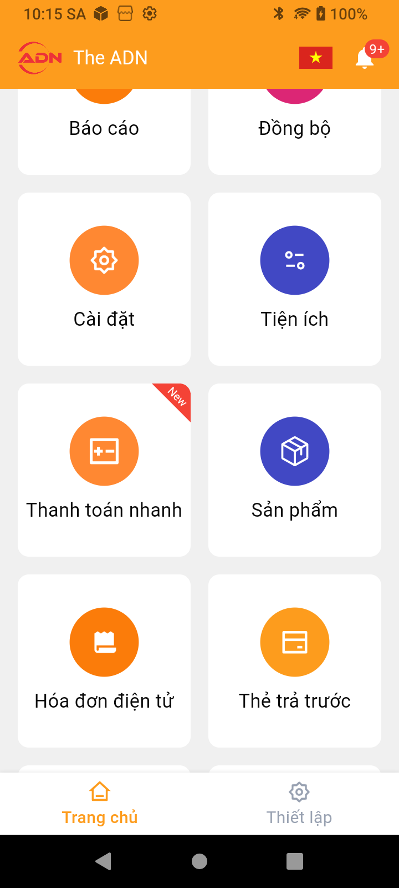<figcaption>
Hình 1. Từ Trang chủ, chọn ô Sản phẩm.
</figcaption></figure>

**Kết quả:** ứng dụng mở màn hình **Danh mục sản phẩm**.

### Bước 2. Bấm dấu cộng để mở các cách tạo

Tại **Danh mục sản phẩm**, bấm nút **+ màu cam** ở góc dưới bên phải.

<figure>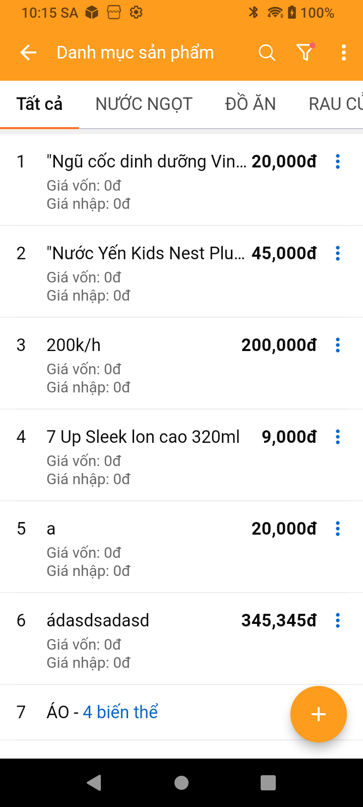<figcaption>
Hình 2. Nút + dùng để thêm sản phẩm.
</figcaption></figure>

### Bước 3. Chọn Tạo sản phẩm chi tiết

Trong menu vừa mở, chọn **Tạo sản phẩm chi tiết**. Không chọn **Tạo sản phẩm tiền giờ** khi đang làm ví dụ món nước có giá cố định này.

<figure>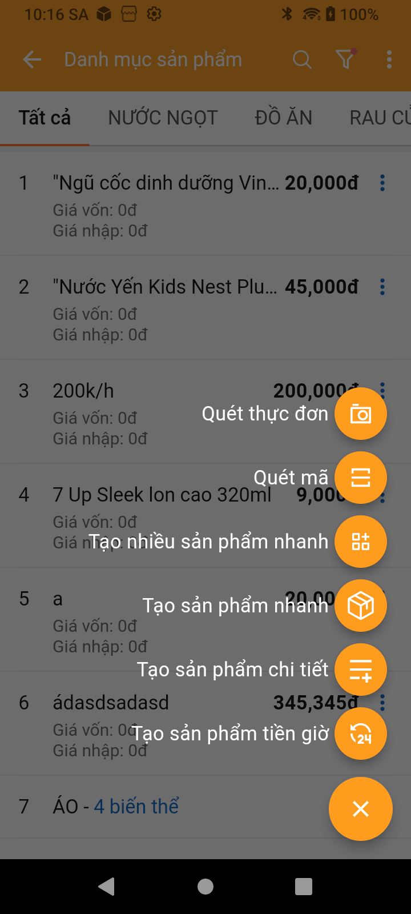<figcaption>
Hình 3. Chọn Tạo sản phẩm chi tiết.
</figcaption></figure>

**Kết quả:** ứng dụng mở **Tạo sản phẩm mới**, có các ô tên, mã, nhóm và phần thêm giá bán. Nút **Lưu** nằm ở góc trên bên phải.

<figure><figcaption>
Hình 4. Biểu mẫu trước khi nhập thông tin.
</figcaption></figure>

## III. Chọn nhóm hoặc tạo nhóm nếu chưa có

### Bước 4. Kiểm tra nhóm đã có chưa

Tại dòng **Nhóm sản phẩm**, bấm **Chọn nhóm** và tìm nhóm phù hợp trong danh sách.

- **Đã có nhóm:** chạm vào tên nhóm, rồi chuyển đến **Bước 8**.
- **Chưa có nhóm:** đóng danh sách bằng nút Quay lại của Android; bấm dấu **+ màu tím ngay bên phải dòng Nhóm sản phẩm** để tạo nhóm. Đây là dấu cộng bên cạnh ô nhóm, không phải dấu cộng cạnh tên sản phẩm.

Thực hiện các bước dưới đây để tạo nhóm **MENU DEMO**.

### Bước 5. Điền tên và phạm vi sử dụng nhóm

Tại màn hình **Tạo nhóm**:

1. Chạm ô **Nhập tên nhóm**, nhập **MENU DEMO**.
2. Giữ **Hoạt động** ở trạng thái bật.
3. Giữ tích **Cho phép bán tại cửa hàng**.
4. Trong ví dụ mẫu, bỏ tích **Cho phép bán trên kênh online**. Với nhóm dùng thực tế, bật mục này nếu cửa hàng muốn bán nhóm hàng đó trên kênh online.
5. **Nhóm cha:** để **Không chọn** nếu muốn tạo nhóm độc lập. Chỉ chọn nhóm cha khi cần tổ chức nhóm con.

<figure>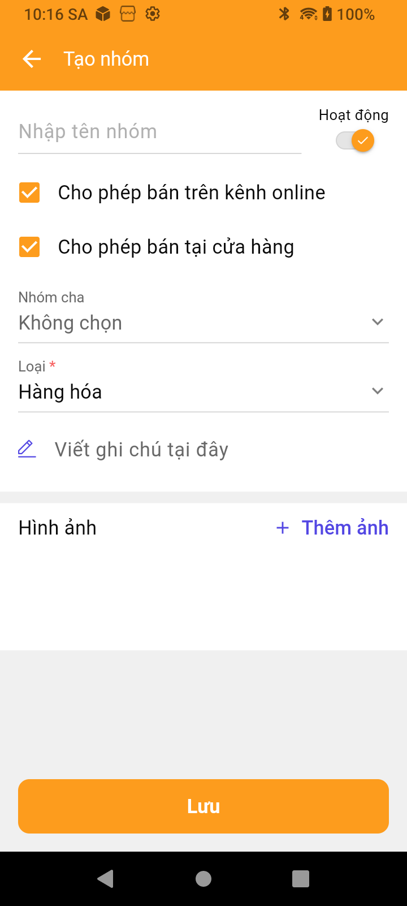<figcaption>
Hình 5. Các trường cần kiểm tra khi tạo nhóm mới.
</figcaption></figure>

### Bước 6. Chọn loại nhóm và lưu

Bấm dòng **Loại**, chọn **Hàng hóa** cho nhóm món nước trong ví dụ.

<figure>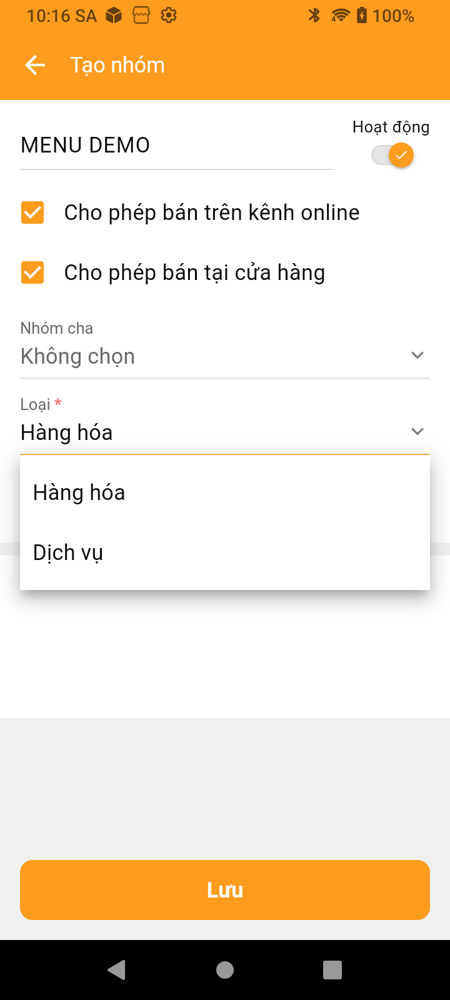<figcaption>
Hình 6. Danh sách loại nhóm có Hàng hóa và Dịch vụ.
</figcaption></figure>

Kiểm tra lại **MENU DEMO**, **Hàng hóa**, trạng thái hoạt động và các lựa chọn kênh bán. Ghi chú, ảnh nhóm có thể bổ sung khi cần; không cần thêm cho ví dụ này. Bấm **Lưu** ở cuối màn hình.

<figure>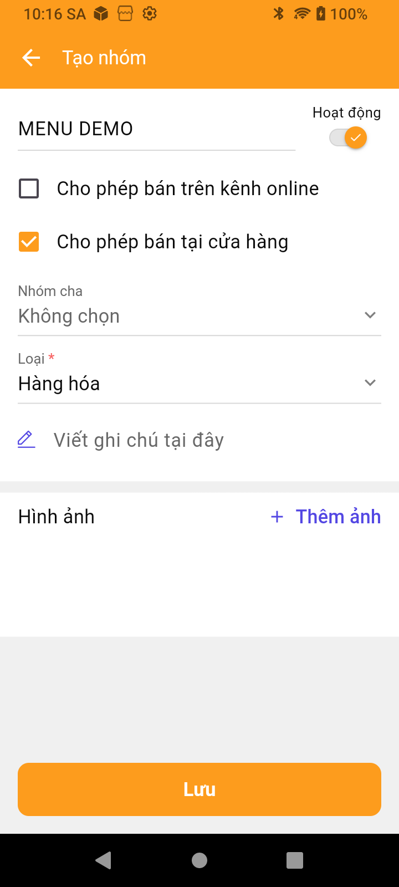<figcaption>
Hình 7. Nhóm MENU DEMO đã điền đủ thông tin, sẵn sàng lưu.
</figcaption></figure>

**Kết quả:** ứng dụng báo **Thêm thành công** và quay về biểu mẫu sản phẩm. Lưu nhóm mới chưa phải là lưu sản phẩm.

### Bước 7. Chọn lại nhóm vừa tạo

Bấm **Chọn nhóm**, cuộn danh sách và chạm **MENU DEMO**. Trong ví dụ, nhóm mới nằm gần cuối danh sách.

<figure>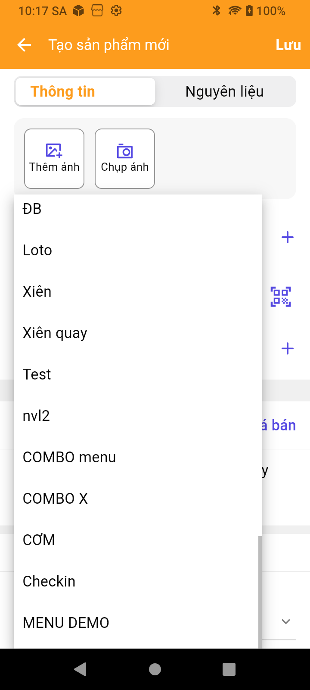<figcaption>
Hình 8. Chạm MENU DEMO để gán nhóm cho sản phẩm.
</figcaption></figure>

**Kiểm tra:** dòng **Nhóm sản phẩm** phải hiển thị **MENU DEMO**, không còn chữ **Chọn nhóm**.

Nếu chưa thấy nhóm mới, xem mục **Không tìm thấy nhóm hoặc đơn vị vừa tạo** ở cuối bài; không tạo thêm một nhóm trùng tên.

## IV. Nhập sản phẩm và giá bán

### Bước 8. Nhập tên, mã và ảnh nếu cần

1. Tại **Tên sản phẩm**, nhập **Matcha Latte Demo**.
2. Tại **Mã sản phẩm**, nhập **HD-MATCHA-01**. Nếu bạn dùng mã riêng, chọn một mã chưa dùng cho sản phẩm khác.
3. Kiểm tra **Nhóm sản phẩm** đang là **MENU DEMO**.
4. Nếu muốn bổ sung ảnh món, chọn **Thêm ảnh** để lấy ảnh có sẵn hoặc **Chụp ảnh** để chụp bằng thiết bị. Ví dụ trong bài để trống ảnh.

<figure>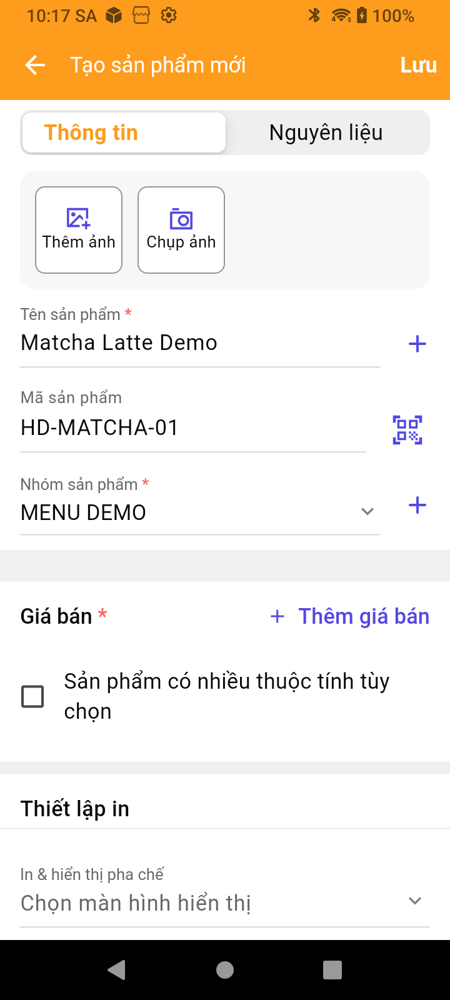<figcaption>
Hình 9. Tên, mã và nhóm của sản phẩm mẫu.
</figcaption></figure>

### Bước 9. Mở phần Thêm giá bán

Bấm **+ Thêm giá bán**. Ứng dụng mở màn hình **Thêm giá bán**, có các mục **Đơn vị bán**, **Giá bán** và **Giá trị quy đổi so với đơn vị cơ bản**.

<figure>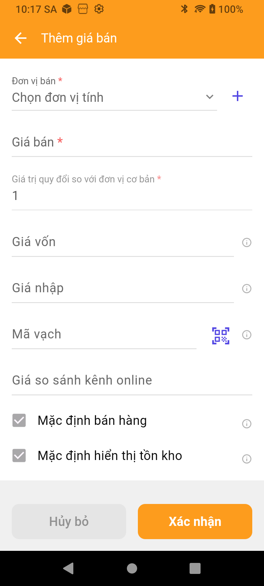<figcaption>
Hình 10. Màn hình Thêm giá bán trước khi nhập.
</figcaption></figure>

### Bước 10. Chọn đơn vị có sẵn hoặc tạo đơn vị mới

**Nếu đã có đơn vị phù hợp:** bấm **Chọn đơn vị tính**, cuộn và chọn đơn vị, chẳng hạn **Ly**; sau đó chuyển đến **Bước 12**.

**Nếu chưa có đơn vị:** bấm dấu **+ màu tím bên phải Đơn vị bán** để mở hộp **Tạo đơn vị tính**.

1. Chạm **Tên đơn vị**.
2. Nhập **Ly Demo** để làm theo ví dụ.
3. Đóng bàn phím nếu đang che nút thao tác.
4. Bấm **Xác nhận** trong hộp **Tạo đơn vị tính**.

<figure>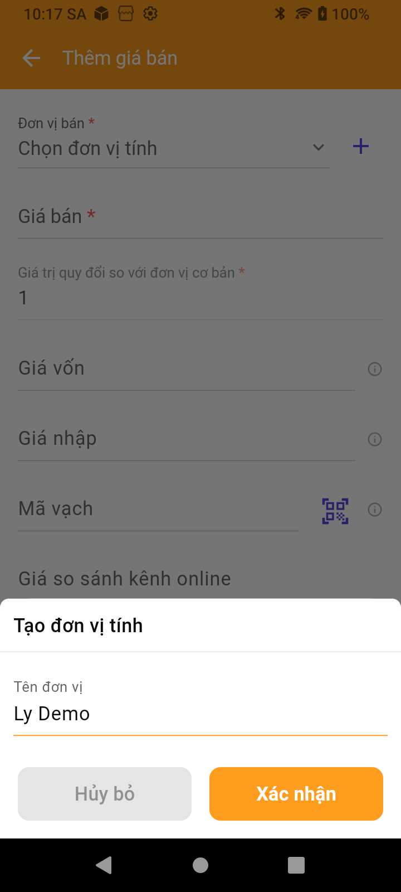<figcaption>
Hình 11. Nhập tên đơn vị Ly Demo, rồi bấm Xác nhận.
</figcaption></figure>

### Bước 11. Chọn lại đơn vị vừa tạo

Sau khi hộp tạo đơn vị đóng, bấm **Chọn đơn vị tính**, cuộn đến **Ly Demo**, rồi chạm để chọn.

<figure>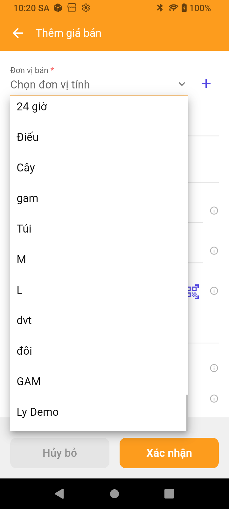<figcaption>
Hình 12. Chọn Ly Demo trong danh sách đơn vị tính.
</figcaption></figure>

**Kiểm tra:** dòng **Đơn vị bán** hiển thị **Ly Demo**. Chỉ tạo đơn vị xong chưa có nghĩa đơn vị đã được chọn cho giá bán.

### Bước 12. Nhập giá và quy đổi

1. Chạm **Giá bán**, nhập **35000**. Biểu mẫu trong ảnh hiển thị **35,000.00**, tương ứng **35.000 đồng**.
2. Giữ **Giá trị quy đổi so với đơn vị cơ bản = 1** cho ví dụ một đơn vị bán này.
3. Ví dụ không nhập **Giá vốn**, **Giá nhập**, **Mã vạch**, **Giá so sánh kênh online**. Khi áp dụng thực tế, nhập các thông tin này theo cách quản lý của cửa hàng.
4. Giữ lựa chọn **Mặc định bán hàng**. Với nhiều đơn vị bán, kiểm tra đúng đơn vị muốn dùng mặc định.

<figure>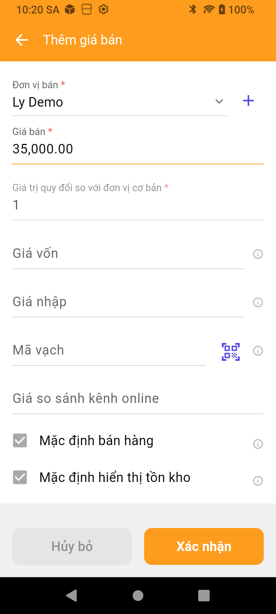<figcaption>
Hình 13. Đơn vị Ly Demo, giá 35.000 đồng và quy đổi 1.
</figcaption></figure>

### Bước 13. Xác nhận thông tin giá

Bấm **Xác nhận** ở cuối màn hình **Thêm giá bán**.

**Kết quả:** quay về biểu mẫu sản phẩm, xuất hiện thẻ **Ly Demo (mặc định)**, giá **35.000 đồng**, quy đổi **1**. Nếu cần sửa giá hoặc đơn vị, chạm biểu tượng **bút chì** trên thẻ giá.

<figure>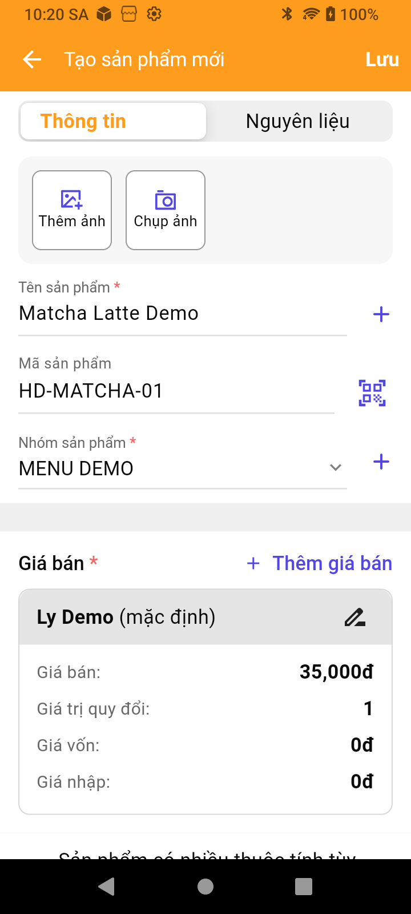<figcaption>
Hình 14. Giá đã được thêm vào biểu mẫu sản phẩm; bước tiếp theo mới lưu sản phẩm.
</figcaption></figure>


Hai nút Xác nhận có mục đích khác nhau: Xác nhận trong hộp Tạo đơn vị tính lưu đơn vị mới; Xác nhận ở màn hình Thêm giá bán đưa đơn vị và giá vào biểu mẫu. Cuối cùng vẫn phải bấm Lưu sản phẩm.


### Bước 14. Kiểm tra các lựa chọn bổ sung

Cuộn xuống biểu mẫu, kiểm tra các mục phù hợp trước khi lưu:

| Mục | Cách dùng trong ví dụ |
| --- | --- |
| Sản phẩm có nhiều thuộc tính tùy chọn | Không tích vì chỉ tạo một món với một mức giá. Nếu có nhiều lựa chọn như size, xem hướng dẫn thuộc tính riêng. |
| In & hiển thị pha chế | Để chưa chọn trong ví dụ. Khi triển khai thực tế, chọn cấu hình pha chế của cửa hàng nếu cần. |
| Quản lý kho | Không tích trong ví dụ; bài này chưa thiết lập tồn kho hoặc định lượng nguyên liệu. |
| Mô tả sản phẩm | Có thể bổ sung nội dung giới thiệu món nếu cần. |
| Bật tắt sử dụng sản phẩm | Kiểm tra đang bật nếu muốn sử dụng sản phẩm. |

Không cần bật quản lý kho chỉ để tạo món. Việc bán món, theo dõi tồn và định lượng nguyên liệu là các cấu hình khác nhau.

## V. Lưu sản phẩm và kiểm tra kết quả

### Bước 15. Bấm Lưu sản phẩm

Kiểm tra lần cuối: **Matcha Latte Demo → HD-MATCHA-01 → MENU DEMO → Ly Demo → 35.000 đồng → quy đổi 1**.

Bấm **Lưu** ở góc trên bên phải màn hình **Tạo sản phẩm mới**. Đợi ứng dụng xử lý, không bấm lưu nhiều lần liên tiếp.

**Kết quả thực tế:** ứng dụng báo **Thêm thành công** và trở về danh mục.

<figure>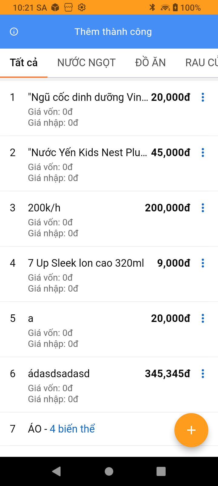<figcaption>
Hình 15. Thông báo Thêm thành công sau khi lưu sản phẩm mẫu.
</figcaption></figure>

### Bước 16. Tìm lại sản phẩm vừa tạo

Tại **Danh mục sản phẩm**:

1. Chọn thẻ **Tất cả** để tránh đang lọc nhầm nhóm.
2. Bấm **kính lúp** trên thanh tiêu đề.
3. Nhập **HD-MATCHA-01** hoặc **Matcha Latte Demo**.
4. Đóng bàn phím nếu đang che danh sách và chờ kết quả tìm kiếm.

<figure>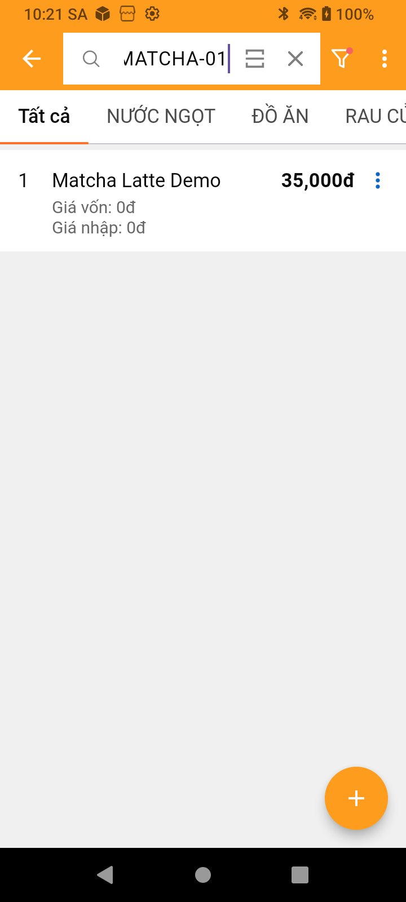<figcaption>
Hình 16. Tìm theo mã HD-MATCHA-01: sản phẩm xuất hiện với giá 35.000 đồng.
</figcaption></figure>

### Bước 17. Mở lại để đối chiếu thông tin

1. Bấm dấu **ba chấm màu xanh ở cuối dòng sản phẩm**.
2. Chọn **Chỉnh sửa sản phẩm**. Không chọn Xóa sản phẩm.

<figure>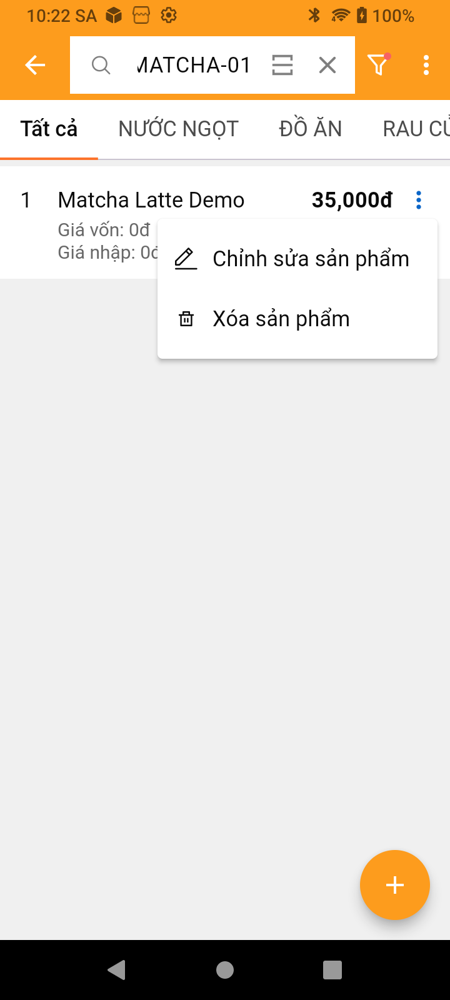<figcaption>
Hình 17. Chọn Chỉnh sửa sản phẩm để kiểm tra thông tin đã lưu.
</figcaption></figure>

Đối chiếu tên **Matcha Latte Demo**, mã **HD-MATCHA-01**, nhóm **MENU DEMO**, đơn vị **Ly Demo**, giá **35.000 đồng** và quy đổi **1**.

<figure>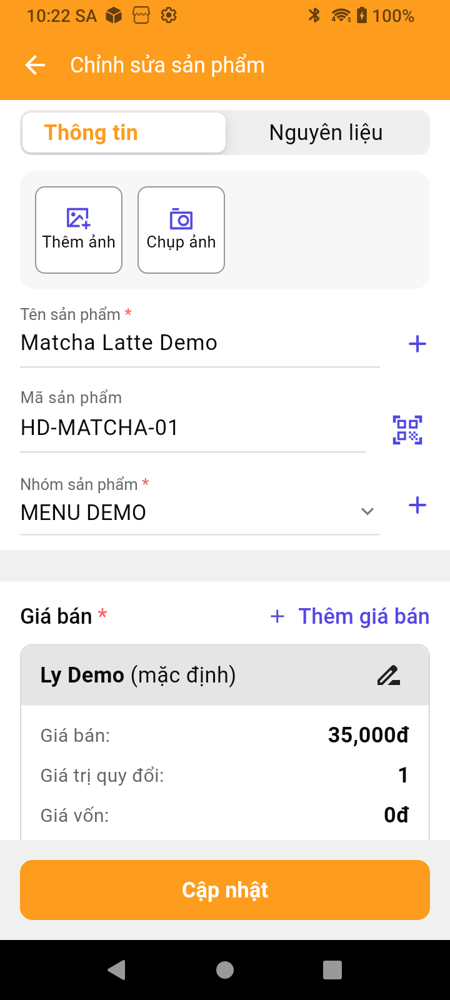<figcaption>
Hình 18. Thông tin mẫu được mở lại sau khi lưu, có đủ nhóm và giá bán.
</figcaption></figure>

Nếu chỉ xem lại, bấm **Quay lại** để thoát. Chỉ bấm **Cập nhật** khi thực sự sửa thông tin.

## VI. Phân biệt nhóm Hàng hóa và nhóm Dịch vụ

Trong **Tạo nhóm → Loại**, ứng dụng có **Hàng hóa** và **Dịch vụ**. Ví dụ món nước trong bài sử dụng nhóm **Hàng hóa**.

Để tạo một nhóm loại dịch vụ, thao tác tại **Tạo nhóm** như sau:

1. Nhập tên nhóm, ví dụ **SERVICE DEMO**.
2. Kiểm tra **Hoạt động**, phạm vi bán và **Nhóm cha** theo nhu cầu.
3. Bấm **Loại**, chọn **Dịch vụ**.
4. Bấm **Lưu**.

<figure>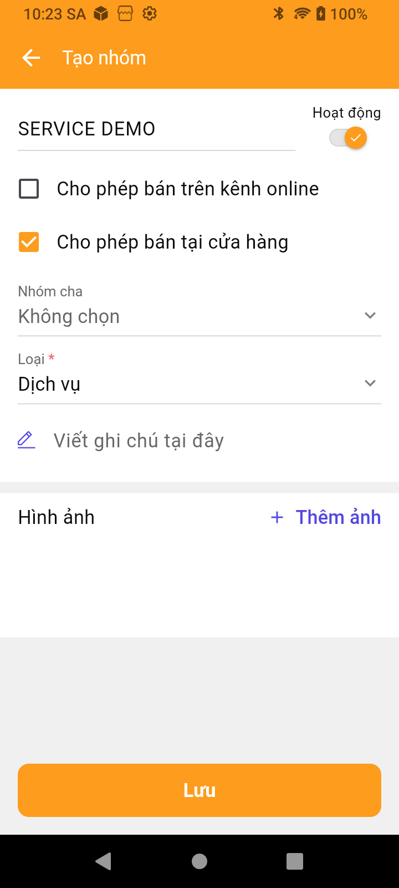<figcaption>
Hình 19. Biểu mẫu nhóm SERVICE DEMO với Loại là Dịch vụ.
</figcaption></figure>

Có thể kiểm tra nhóm đã tạo bằng đường dẫn **Danh mục sản phẩm → ba chấm trên thanh tiêu đề → Danh sách nhóm**. Danh sách thực tế hiển thị **MENU DEMO — Hàng hóa** và **SERVICE DEMO — Dịch vụ**.

<figure>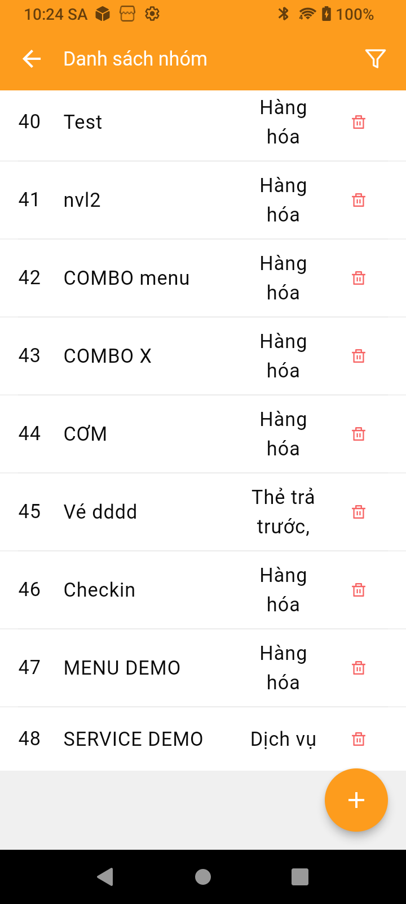<figcaption>
Hình 20. Hai nhóm mẫu đã lưu, có loại nhóm khác nhau.
</figcaption></figure>


Trên thiết bị và phiên bản dùng trong bài, nhóm loại Dịch vụ đã lưu nhưng không xuất hiện trong danh sách chọn nhóm của luồng Tạo sản phẩm chi tiết FnB. Vì vậy, không áp dụng máy móc luồng món nước này để tạo dịch vụ. Phần VI xác nhận cách tạo nhóm Dịch vụ; không phải hướng dẫn hoàn tất tạo một dịch vụ bán hàng. Cần kiểm tra phân hệ dịch vụ phù hợp của cửa hàng trước khi tiếp tục.


## VII. Các tình huống thường gặp

### Không thấy nhóm hoặc đơn vị vừa tạo

Kiểm tra đã bấm **Lưu** nhóm hoặc **Xác nhận** đơn vị. Đóng và mở lại danh sách, cuộn đến cuối để tìm tên mới. Nếu danh sách vẫn chưa cập nhật, quay lại và mở lại màn hình thao tác; ghi lại thông tin đang nhập trước khi rời biểu mẫu để tránh phải nhập lại.

Trong lần thực hành này, khi mở lại danh sách/màn hình, dữ liệu mới được hiển thị đầy đủ. Không tạo thêm nhiều nhóm hoặc đơn vị cùng tên chỉ vì danh sách chưa kịp cập nhật.

### Đã Xác nhận giá nhưng không tìm thấy sản phẩm

**Xác nhận giá chưa lưu sản phẩm.** Quay lại biểu mẫu, kiểm tra thẻ giá rồi bấm **Lưu** ở góc trên bên phải. Chỉ kiểm tra danh mục sau khi ứng dụng báo thành công.

### Chưa nhập đủ thông tin bắt buộc

Các trường có dấu **\*** cần được điền hoặc chọn. Kiểm tra **Tên sản phẩm**, **Nhóm sản phẩm** và thẻ **Giá bán**; trong phần giá kiểm tra **Đơn vị bán**, **Giá bán**, **Giá trị quy đổi**. Đọc thông báo của ứng dụng để sửa đúng mục còn thiếu.

### Tìm không thấy sản phẩm sau khi lưu

Chọn **Tất cả**, kiểm tra lại đúng cửa hàng và tìm theo đúng mã hoặc tên. Nếu đang lọc nhóm khác, kết quả có thể không bao gồm sản phẩm mới.

### Cần sửa giá vừa nhập

Trước khi lưu, chạm **bút chì** trên thẻ giá. Sau khi đã lưu, tìm sản phẩm → ba chấm cuối dòng → **Chỉnh sửa sản phẩm**, sửa thông tin rồi bấm **Cập nhật**.

### Sản phẩm có nhiều size hoặc tính tiền theo giờ

Với size, xem [Sản phẩm có nhiều thuộc tính tùy chọn](../san-pham-co-nhieu-thuoc-tinh-tuy-chon.md). Với tiền giờ, menu dấu cộng có mục **Tạo sản phẩm tiền giờ**; đây là luồng riêng, không dùng quy đổi/giá của ví dụ Matcha Latte để thay thế cấu hình thời gian.

## Video tham khảo

Video có sẵn trong tài liệu trước đây:


