# Thêm sản phẩm trên web

Truy cập [admin.posapp.vn](https://admin.posapp.vn/) và đăng nhập tài khoản có quyền quản lý sản phẩm. Các giá bán, giá vốn và công thức dưới đây là dữ liệu mẫu để thực hành.

## 1. Chọn cách quản lý sản phẩm

| Bạn muốn tạo | Quản lý tồn kho | Sản xuất trừ nguyên vật liệu | Khai báo nguyên liệu |
| --- | --- | --- | --- |
| Hàng bán theo một hoặc nhiều đơn vị, như nước suối, nước ngọt | Bật nếu cần theo dõi số lượng hàng | Tắt | Không |
| Nguyên vật liệu, như cà phê bột, sữa, đường | Bật | Tắt | Không |
| Món pha chế khi khách gọi, như cà phê sữa | Tắt | Tắt | Theo lượng dùng cho một đơn vị bán |
| Thành phẩm làm sẵn rồi mới bán, như bánh flan | Bật | Bật | Theo lượng dùng để sản xuất một thành phẩm |

**Phân biệt thời điểm trừ kho:** bán cà phê sữa sẽ trừ nguyên liệu; sản xuất bánh flan sẽ trừ nguyên liệu và tăng tồn bánh; bán bánh flan sẽ trừ tồn bánh.

## 2. Mở màn hình thêm sản phẩm

1. Trong menu bên trái, chọn **Sản phẩm - Dịch vụ**.
2. Chọn tiếp **Sản phẩm - Dịch vụ** trong menu vừa mở.
3. Nhấn **Thêm Mới** ở góc trên bên phải, chọn **Sản phẩm**.

<figure>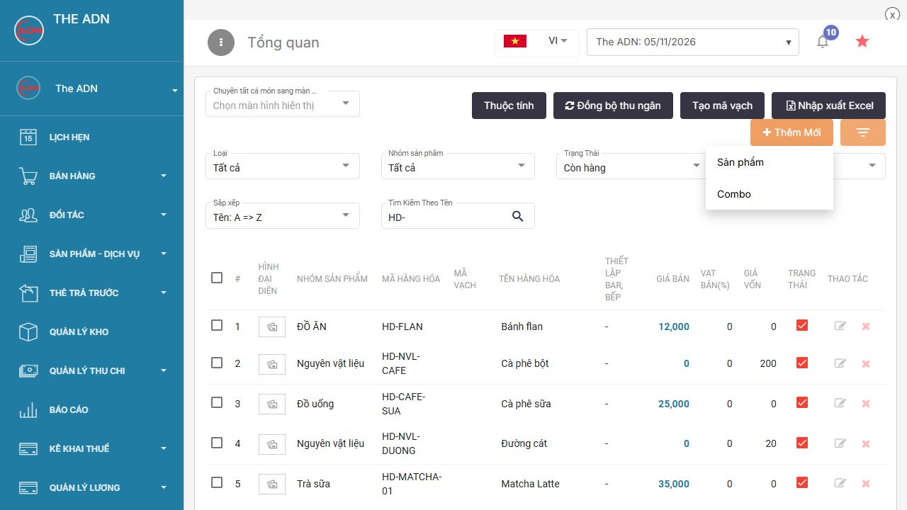<figcaption>
Mở biểu mẫu tạo sản phẩm
</figcaption></figure>

4. Trong **Thông tin chung**, nhập **Tên hàng hóa**, **Mã sản phẩm** và chọn **Nhóm sản phẩm**. Có thể để trống mã để hệ thống tự tạo. Mã tự nhập phải khác mã đã có.
5. Nếu chưa có nhóm phù hợp, nhấn dấu **+** cạnh ô **Nhóm sản phẩm**, tạo nhóm rồi chọn lại.
6. Nhập **Mô tả** hoặc nhấn **Thêm ảnh** nếu cần. Ảnh sản phẩm có dung lượng tối đa 5 MB.

## 3. Ví dụ sản phẩm một đơn vị tính

Tạo nước suối chỉ bán theo chai.

### Bước 1 Nhập thông tin và nơi bán

| Trường | Giá trị mẫu |
| --- | --- |
| Tên hàng hóa | Nước suối 500 ml |
| Mã sản phẩm | HD-NUOC500 |
| Nhóm sản phẩm | Đồ uống |
| Cho phép bán tại cửa hàng | Bật |
| Cho phép bán hàng online | Tắt nếu chỉ bán tại cửa hàng |

<figure>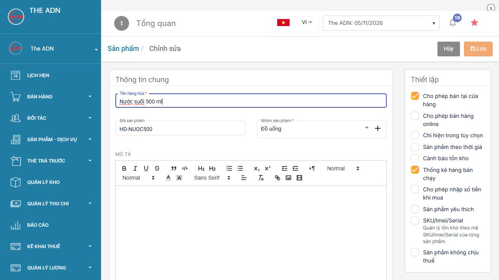<figcaption>
Nhập tên mã và nhóm sản phẩm
</figcaption></figure>

### Bước 2 Thiết lập kho

1. Kéo xuống **Quản lý kho**, bật **Quản lý tồn kho** để theo dõi số chai.
2. Tắt **Cho phép bán khi hết tồn kho** nếu cần chặn bán khi hết hàng.
3. Giữ **Sản xuất trừ nguyên vật liệu** ở trạng thái tắt.

<figure>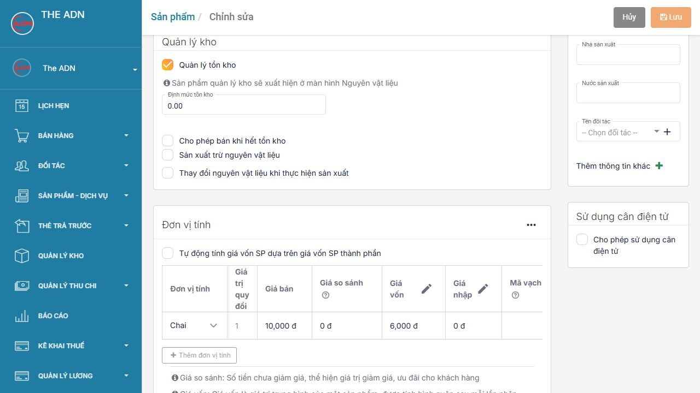<figcaption>
Cấu hình hàng bán trừ tồn của chính sản phẩm
</figcaption></figure>

### Bước 3 Nhập đơn vị và giá

Tại **Đơn vị tính**, nhấn ô trống ở dòng đầu và chọn **Chai**. Nhập:

| Đơn vị tính | Giá trị quy đổi | Giá bán | Giá vốn |
| --- | --- | --- | --- |
| Chai | 1 | 10.000 đ | 6.000 đ |

Chọn **Chai** làm **Mặc định bán hàng** và **Mặc định tồn kho**. Với một đơn vị, hệ thống chọn mặc định sau khi chọn đơn vị.

<figure>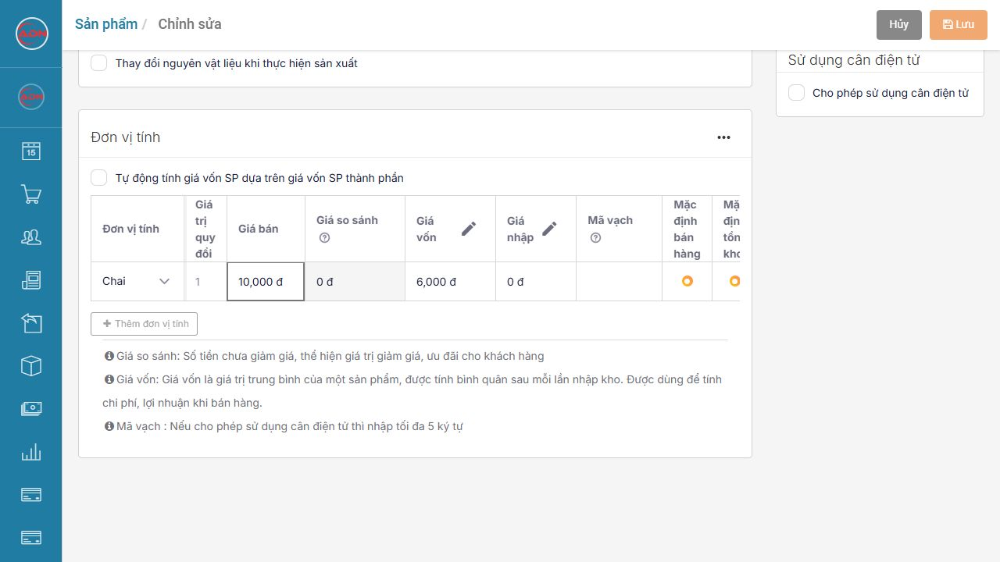<figcaption>
Đơn vị và giá của nước suối
</figcaption></figure>

Nếu chưa có đơn vị cần dùng, nhấn dấu **…** trong khung **Đơn vị tính**, chọn **Thêm đơn vị tính**, nhập tên rồi lưu. Quay lại ô đơn vị để chọn tên vừa tạo.

### Bước 4 Lưu sản phẩm

Nhấn **Lưu** ở góc trên bên phải. Tạo sản phẩm không tự tạo số lượng tồn kho. Nhập kho nước suối trước khi bán nếu đã tắt bán khi hết tồn.

**Kết quả:** có một sản phẩm nước suối, giá 10.000 đ/chai. Khi phát sinh bán hàng, hệ thống trừ số chai đã bán.

## 4. Ví dụ sản phẩm nhiều đơn vị tính

Tạo nước ngọt vừa bán theo lon, vừa bán theo lốc; **1 lốc = 6 lon**.

1. Mở biểu mẫu thêm sản phẩm như mục 2.
2. Nhập tên **Nước ngọt lon 330 ml**, mã **HD-NUOCNGOT**, nhóm **Đồ uống**.
3. Bật **Cho phép bán tại cửa hàng** và **Quản lý tồn kho**. Tắt **Sản xuất trừ nguyên vật liệu**. Chọn có cho bán khi hết tồn hay không theo cách quản lý của cửa hàng.
4. Trong **Đơn vị tính**, chọn **lon** ở dòng đầu. Đơn vị đầu tiên là đơn vị nhỏ nhất, có giá trị quy đổi **1**.
5. Nhấn **Thêm đơn vị tính** bên dưới bảng, chọn **Lốc** ở dòng mới và nhập giá trị quy đổi **6**.
6. Điền giá riêng cho từng dòng:

| Đơn vị tính | Giá trị quy đổi | Giá bán | Giá vốn |
| --- | --- | --- | --- |
| lon | 1 | 15.000 đ | 9.000 đ |
| Lốc | 6 | 85.000 đ | 54.000 đ |

7. Chọn **lon** làm **Mặc định bán hàng** và **Mặc định tồn kho**. Nhấn **Lưu**.

<figure>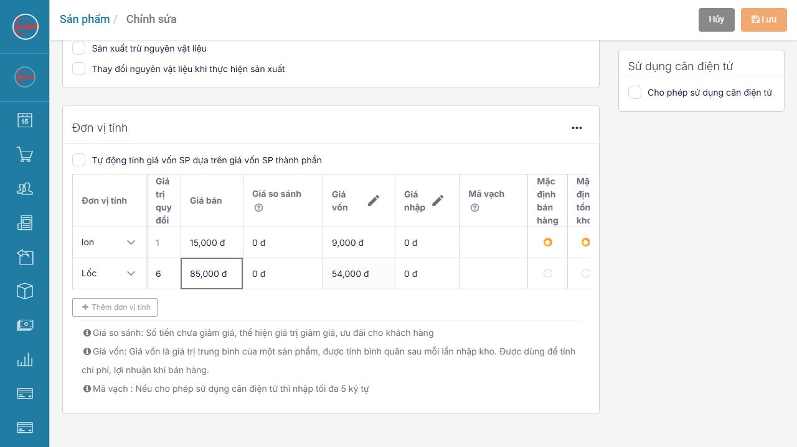<figcaption>
Một lốc quy đổi thành sáu lon
</figcaption></figure>

**Kiểm tra quy đổi:** nếu tồn 24 lon, bán 1 lốc thì còn 18 lon. Giá bán một lốc là 85.000 đ theo dòng đã khai báo, không bắt buộc bằng 6 lần giá bán lẻ.

Với các lựa chọn không có tỷ lệ quy đổi cố định, như trà sữa Size M và Size L, có thể để cả hai tỷ lệ bằng 1. Nếu có định lượng, khai báo công thức riêng cho từng size; không dùng tỷ lệ lon/lốc để quy đổi size.

## 5. Tạo nguyên vật liệu trước khi khai báo công thức

Nguyên vật liệu cũng được tạo tại **Thêm Mới → Sản phẩm**. Tạo và lưu từng nguyên liệu trước khi gán vào món.

| Tên hàng hóa | Mã mẫu | Đơn vị | Giá vốn cho một đơn vị |
| --- | --- | --- | --- |
| Cà phê bột | HD-NVL-CAFE | gr | 200 đ/gr |
| Sữa đặc | HD-NVL-SUADAC | ml | 60 đ/ml |
| Sữa tươi | HD-NVL-SUATUOI | ml | 30 đ/ml |
| Đường cát | HD-NVL-DUONG | gr | 20 đ/gr |
| Trứng gà | HD-NVL-TRUNG | quả | 3.000 đ/quả |

Thực hiện với từng nguyên liệu:

1. Nhập tên, mã và chọn nhóm **Nguyên vật liệu** hoặc nhóm nguyên liệu của cửa hàng.
2. Tắt **Cho phép bán tại cửa hàng** và **Cho phép bán hàng online** nếu nguyên liệu chỉ dùng để chế biến.
3. Bật **Quản lý tồn kho**; tắt **Sản xuất trừ nguyên vật liệu**.
4. Chọn đơn vị trong bảng và nhập giá vốn theo đúng đơn vị đó. Nguyên liệu không bán trực tiếp có thể để giá bán bằng 0.
5. Nhấn **Lưu**, sau đó tạo nguyên liệu tiếp theo.

<figure>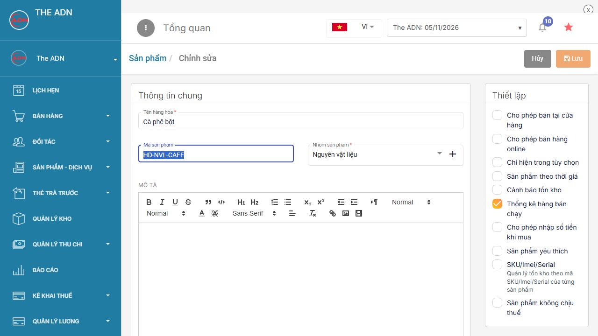<figcaption>
Tạo nguyên liệu và ẩn khỏi menu bán hàng
</figcaption></figure>

<figure>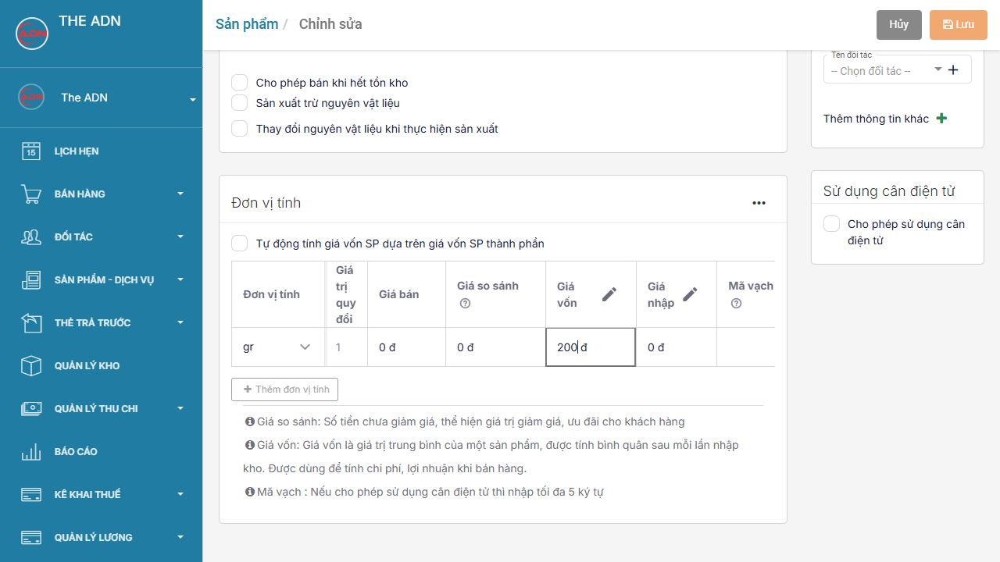<figcaption>
Giá vốn nguyên liệu tính theo đơn vị đã chọn
</figcaption></figure>

Nếu nhập cà phê theo kg nhưng định lượng theo gr, tạo **gr** trước với tỷ lệ **1**, thêm **kg** với tỷ lệ **1.000**. Không nhập giá vốn của 1 kg vào dòng gr.

## 6. Ví dụ sản phẩm có định lượng nguyên vật liệu

Tạo cà phê sữa pha khi khách gọi. Công thức mẫu cho **1 ly** gồm **20 gr cà phê bột + 25 ml sữa đặc**. Bổ sung nước, đá hoặc vật tư khác nếu cửa hàng cần theo dõi các thành phần đó.

### Bước 1 Tạo món và đơn vị bán

1. Tạo sản phẩm tên **Cà phê sữa**, mã **HD-CAFE-SUA**, nhóm **Đồ uống**.
2. Bật **Cho phép bán tại cửa hàng**; bật bán online nếu sử dụng kênh đó.
3. **Không bật Quản lý tồn kho** và **không bật Sản xuất trừ nguyên vật liệu**. Món này theo dõi tồn nguyên liệu, không theo dõi số ly thành phẩm làm sẵn.
4. Chọn đơn vị **ly**, tỷ lệ **1**, giá bán **25.000 đ**.

### Bước 2 Chọn nguyên liệu

1. Kéo xuống **Bán hàng trừ nguyên vật liệu** và chọn tab **ly**.
2. Nhấn **Tìm kiếm nguyên vật liệu**.
3. Trong cửa sổ **Tìm kiếm từ kho hàng hóa**, nhập tên hoặc mã nguyên liệu rồi nhấn biểu tượng **kính lúp**.
4. Nhấn dòng **Cà phê bột** và **Sữa đặc** để chọn. Tab **Đã chọn** hiển thị số nguyên liệu đã chọn.
5. Nhấn **Xác nhận** để đưa nguyên liệu vào công thức.

<figure>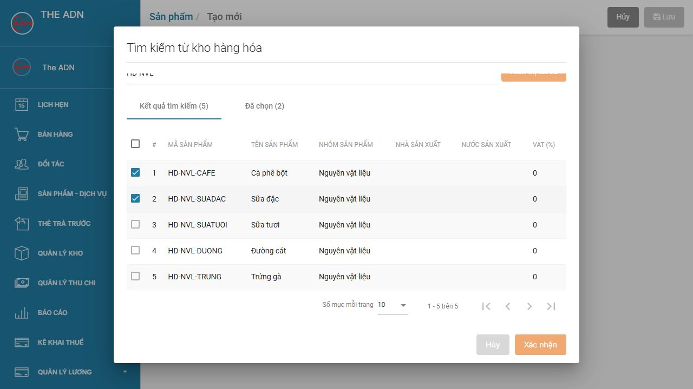<figcaption>
Chọn hai nguyên liệu rồi nhấn Xác nhận
</figcaption></figure>

### Bước 3 Nhập định lượng và lưu

| Nguyên liệu | Số lượng cho 1 ly | Đơn vị |
| --- | --- | --- |
| Cà phê bột | 20 | gr |
| Sữa đặc | 25 | ml |

Nhập số lượng tại từng dòng và kiểm tra đơn vị. Nhấn ra ngoài ô để kết thúc nhập, kiểm tra lại số lượng rồi nhấn **Lưu**.

<figure>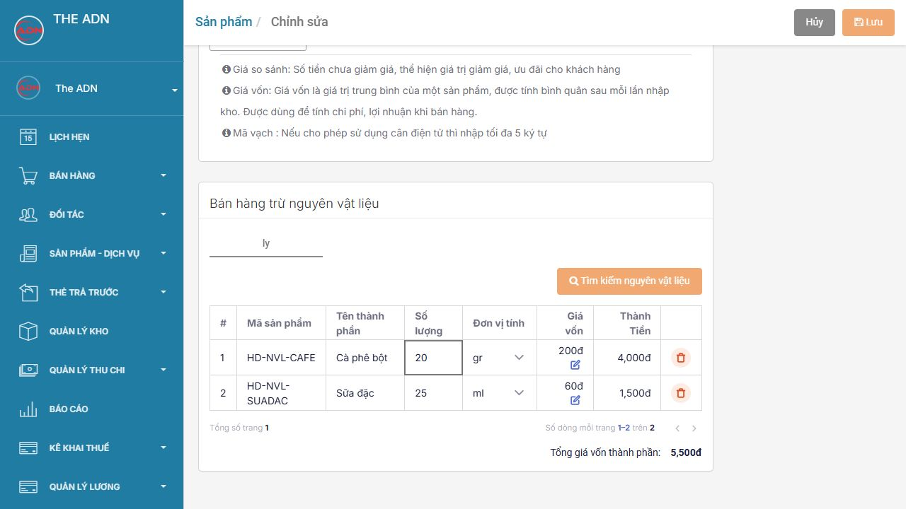<figcaption>
Khai báo lượng dùng cho một ly
</figcaption></figure>

**Kết quả:** bán 1 ly sẽ trừ 20 gr cà phê bột và 25 ml sữa đặc; bán 3 ly sẽ trừ 60 gr cà phê bột và 75 ml sữa đặc. Giá vốn nguyên liệu mẫu của 1 ly là **5.500 đ**.

Nếu món có nhiều đơn vị hoặc size, chọn lần lượt từng tab trong phần định lượng và nhập công thức tương ứng trước khi lưu.

## 7. Ví dụ sản phẩm có sản xuất

Tạo bánh flan làm sẵn để bán. Công thức mẫu cho **1 cái**: **0,5 quả trứng + 50 ml sữa tươi + 10 gr đường**. Thay bằng công thức thực tế của cửa hàng khi sử dụng.

### Bước 1 Tạo thành phẩm và bật sản xuất

1. Tạo sản phẩm tên **Bánh flan**, mã **HD-FLAN**, nhóm **ĐỒ ĂN**.
2. Bật **Cho phép bán tại cửa hàng**; chọn bán online theo nhu cầu.
3. Trong **Quản lý kho**, bật **Quản lý tồn kho**, sau đó bật **Sản xuất trừ nguyên vật liệu**.
4. Tắt **Cho phép bán khi hết tồn kho** nếu chỉ cho bán số bánh đã sản xuất.
5. Giữ **Thay đổi nguyên vật liệu khi thực hiện sản xuất** ở trạng thái tắt để dùng công thức cố định của ví dụ.
6. Chọn đơn vị **cái**, tỷ lệ **1**, giá bán **12.000 đ**.

<figure>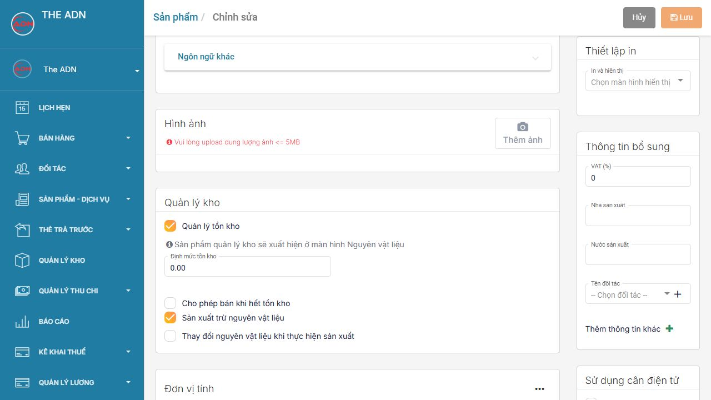<figcaption>
Hai cấu hình bắt buộc của thành phẩm sản xuất
</figcaption></figure>

### Bước 2 Khai báo nguyên liệu cho một thành phẩm

1. Kéo xuống **Nguyên vật liệu tiêu hao khi sản xuất hàng hóa**, chọn tab **cái**.
2. Nhấn **Tìm kiếm nguyên vật liệu**; tìm và chọn **Trứng gà**, **Sữa tươi**, **Đường cát** rồi nhấn **Xác nhận**.
3. Nhập định lượng:

| Nguyên liệu | Số lượng cho 1 cái | Đơn vị |
| --- | --- | --- |
| Trứng gà | 0,5 | quả |
| Sữa tươi | 50 | ml |
| Đường cát | 10 | gr |

Với ô số dùng dấu chấm thập phân như ảnh, nhập **0.5** để thể hiện nửa quả trứng.

4. Kiểm tra lại từng số lượng và đơn vị, nhấn **Lưu**. Công thức này dành cho **1 cái**, không nhập toàn bộ lượng dùng cho một mẻ.

<figure>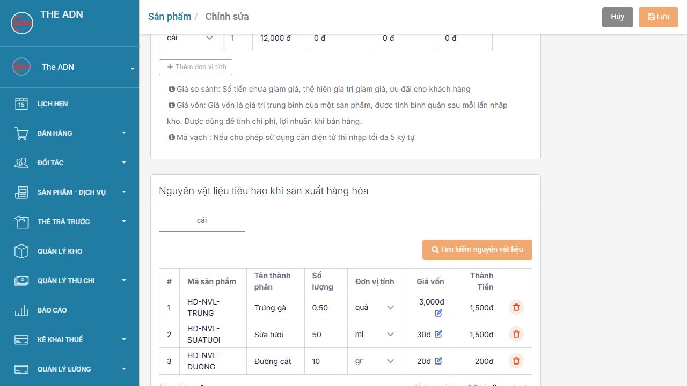<figcaption>
Định lượng được nhân theo số bánh cần sản xuất
</figcaption></figure>

### Bước 3 Tạo tồn thành phẩm trước khi bán

Lưu sản phẩm mới chỉ lưu cấu hình và công thức, chưa làm tăng tồn bánh.

1. [Nhập kho nguyên liệu](../../quan-ly-kho/nhap-xuat-hang-web/nhap-hang.md) theo số lượng thực tế.
2. Mở **Sản phẩm - Dịch vụ → Sản xuất**, tạo phiếu sản xuất.
3. Chọn kho, chọn **Bánh flan**, nhập số lượng cần sản xuất và kiểm tra nguyên liệu tiêu hao trước khi lưu phiếu. Nếu chưa có mục **Sản xuất**, xem cách bật tại [Tính năng sản xuất](../tinh-nang-san-xuat.md).

Ví dụ, phiếu sản xuất **20 cái** sẽ dùng **10 quả trứng, 1.000 ml sữa tươi, 200 gr đường** theo công thức trên và tăng tồn bánh thêm **20 cái**. Sau đó bán **3 cái** thì tồn bánh còn **17 cái** nếu trước đó chưa có bánh tồn; nguyên liệu đã được trừ ở bước sản xuất.

## 8. Thiết lập hiển thị và in bếp

| Tùy chọn | Chọn khi nào |
| --- | --- |
| Cho phép bán tại cửa hàng | Bật để nhân viên chọn sản phẩm trên menu bán hàng tại cửa hàng |
| Cho phép bán hàng online | Bật khi cần bán trên kênh online đã kết nối; tùy chọn này độc lập với bán tại cửa hàng |
| Chỉ hiện trong tùy chọn | Dùng cho topping hoặc sản phẩm chỉ chọn kèm món khác |
| Cho phép bán khi hết tồn kho | Chỉ dùng với sản phẩm quản lý tồn; bật sẽ cho phép bán làm tồn âm |

Ví dụ tồn 0 chai mà vẫn cho bán thêm 5 chai thì tồn là **-5 chai**; nhập thêm 20 chai thì còn **15 chai**.

Với món cần gửi bếp/bar, mở **Thiết lập in → In và hiển thị** và chọn vị trí máy in phù hợp. Máy in 1 đến 6 phải tương ứng với máy in đã cài trên thiết bị bán hàng. Có thể chọn nhiều máy in cho một món nếu cần gửi nhiều khu vực.

## 9. Kiểm tra sau khi lưu

1. Quay lại **Sản phẩm - Dịch vụ**, nhập tên hoặc mã ở ô **Tìm Kiếm Theo Tên** rồi nhấn **kính lúp**. Có thể chọn **Sắp xếp → Ngày cập nhật: Mới nhất** để tìm sản phẩm vừa lưu.
2. Kiểm tra tên, nhóm và giá bán trong danh sách. Nhấn biểu tượng **bút chì** ở dòng sản phẩm để mở lại đơn vị, tỷ lệ quy đổi và định lượng đã lưu.
3. Với món bán tại cửa hàng, đồng bộ dữ liệu trên thiết bị thu ngân rồi kiểm tra sản phẩm trên menu.
4. Với sản phẩm quản lý tồn, kiểm tra đã có tồn kho trước khi bán nếu không cho phép tồn âm.

<figure>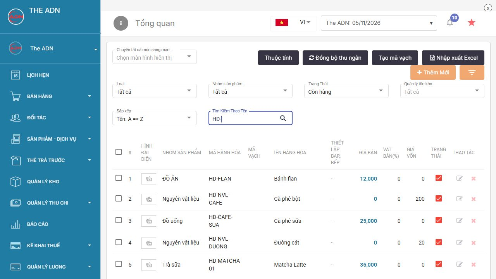<figcaption>
Kiểm tra sản phẩm đã lưu trong danh sách
</figcaption></figure>

| Vướng mắc | Cách xử lý |
| --- | --- |
| Không lưu được sản phẩm | Kiểm tra tên, nhóm, đơn vị tính và các ô đang báo lỗi; kiểm tra mã không trùng |
| Không thấy phần định lượng | Với món pha theo order, tắt Quản lý tồn kho; với thành phẩm, bật cả Quản lý tồn kho và Sản xuất trừ nguyên vật liệu |
| Không tìm được nguyên liệu | Tạo và lưu nguyên liệu trước; kiểm tra lại tên hoặc mã khi tìm kiếm |
| Bán một lốc nhưng trừ sai số lon | Kiểm tra lon là đơn vị đầu tiên có tỷ lệ 1, lốc có tỷ lệ 6 |
| Bánh flan chưa có số lượng để bán | Nhập nguyên liệu và lập phiếu sản xuất; chỉ lưu sản phẩm chưa tạo tồn thành phẩm |
| Sản phẩm chưa xuất hiện trên menu | Kiểm tra Cho phép bán tại cửa hàng, trạng thái sản phẩm và đồng bộ dữ liệu thu ngân |
