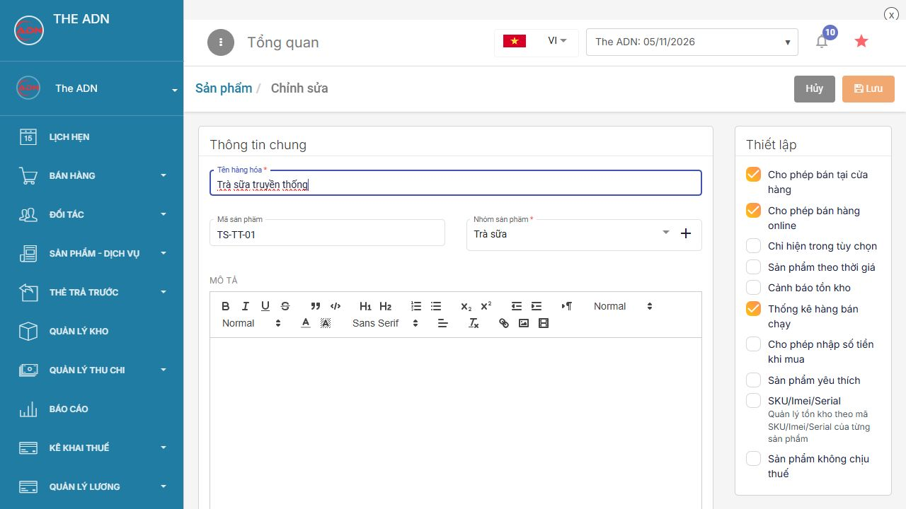
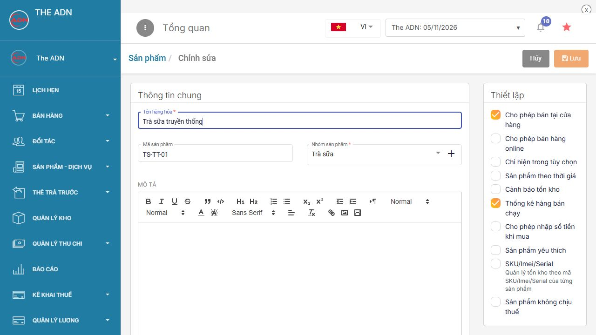
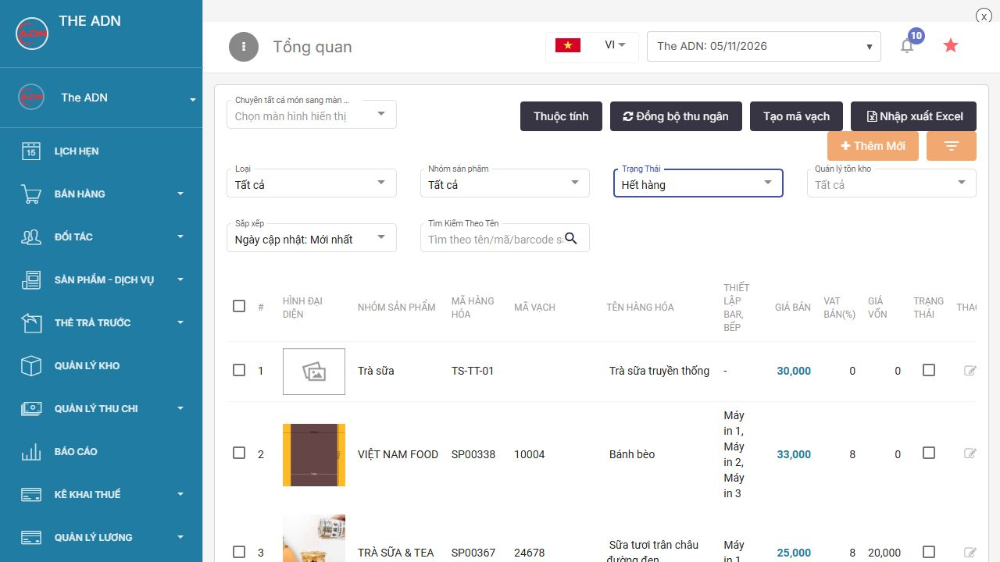

# Bật tắt sản phẩm

**Cho phép bán tại cửa hàng** và **Cho phép bán hàng online** chọn nơi được bán. **Trạng Thái** trong danh sách sản phẩm dùng để bật hoặc tạm ngừng bán món. Ba phần này cần được kiểm tra riêng.

## 1. Ý nghĩa từng thiết lập

| Thiết lập | Khi bật | Khi tắt |
| --- | --- | --- |
| Cho phép bán tại cửa hàng | Món được phép xuất hiện để bán tại quầy/POS | Món không bán độc lập trên menu tại cửa hàng |
| Cho phép bán hàng online | Món được phép bán trên kênh online đã kết nối | Món không được bán trên kênh online đó |
| Trạng Thái trong danh sách | Dấu tích tương ứng trạng thái Còn hàng/đang sử dụng | Bỏ tích tương ứng Hết hàng/tạm ngừng sử dụng |

**Còn hàng/Hết hàng ở bộ lọc trạng thái không phải số lượng tồn kho thực tế.** Thay trạng thái không phải lập phiếu nhập/xuất kho. Với sản phẩm quản lý tồn, hệ thống còn kiểm tra tồn kho và thiết lập **Cho phép bán khi hết tồn kho**.

## 2. Mẫu sản phẩm để thực hành

Tạo **Trà sữa truyền thống**, mã **TS-TT-01**, nhóm **Trà sữa**, đơn vị **ly**, giá **30.000 đ**. Ban đầu bật cả hai kênh bán và để trạng thái **Còn hàng**. Nếu đã có món này, mở đúng mã để thực hành.

| Mục tiêu | Bán tại cửa hàng | Bán online | Trạng thái |
| --- | --- | --- | --- |
| Bán ở cả quầy và online | Bật | Bật | Còn hàng |
| Chỉ bán ở quầy | Bật | Tắt | Còn hàng |
| Chỉ bán online | Tắt | Bật | Còn hàng |
| Tạm ngừng bán món | Giữ cấu hình kênh đã chọn | Giữ cấu hình kênh đã chọn | Hết hàng |

## 3. Bật hoặc tắt kênh bán trên web

1. Đăng nhập [admin.posapp.vn](https://admin.posapp.vn/), chọn **Sản phẩm - Dịch vụ → Sản phẩm - Dịch vụ**.
2. Nhập **TS-TT-01** vào ô tìm kiếm, nhấn **kính lúp**. Nếu không thấy món, chuyển bộ lọc **Trạng Thái** sang **Tất cả** rồi tìm lại.
3. Nhấn **bút chì** ở đúng dòng **Trà sữa truyền thống**.
4. Trong khung **Thiết lập**, kiểm tra **Cho phép bán tại cửa hàng** và **Cho phép bán hàng online**.

<figure><figcaption>
Hai thiết lập kênh bán độc lập
</figcaption></figure>

5. Để món chỉ bán ở quầy, giữ **Cho phép bán tại cửa hàng** và bỏ tích **Cho phép bán hàng online**.
6. Nhấn **Lưu**, mở lại món để kiểm tra hai dấu tích đã lưu đúng.

<figure><figcaption>
Mẫu cấu hình chỉ bán tại quầy
</figcaption></figure>

Muốn bán lại online, tích lại **Cho phép bán hàng online** rồi **Lưu**. Bật cờ này không thay thế việc kết nối kênh online hoặc cấu hình thực đơn trên kênh đó.

## 4. Tạm báo hết món và mở bán lại

Ví dụ quầy hết nguyên liệu làm **Trà sữa truyền thống** trong hôm nay:

1. Mở danh sách sản phẩm, tìm **TS-TT-01**.
2. Tại cột **Trạng Thái**, bỏ tích ở dòng món. Thao tác trạng thái được ghi nhận ngay trên danh sách.
3. Chọn bộ lọc **Trạng Thái → Hết hàng** và tìm lại mã để kiểm tra món đang nằm ở trạng thái tạm ngừng bán.

<figure><figcaption>
Tìm món đã tạm ngừng bán trong bộ lọc Hết hàng
</figcaption></figure>

4. Khi bán lại, trong bộ lọc **Hết hàng** hoặc **Tất cả**, tích lại ô **Trạng Thái** của món.
5. Chuyển bộ lọc về **Còn hàng**, tìm lại và kiểm tra. Đồng bộ dữ liệu trên thu ngân trước khi bán tiếp.

Không cần xóa món rồi tạo lại khi chỉ tạm hết hàng. Giá, nhóm và công thức vẫn cần được giữ để sử dụng khi mở bán lại.

## 5. Khi đã bật nhưng vẫn không thấy món

1. Kiểm tra đúng cửa hàng/chi nhánh và đúng mã sản phẩm.
2. Kiểm tra bộ lọc **Trạng Thái**, tránh đang xem riêng danh sách Hết hàng.
3. Kiểm tra món và nhóm chứa món có bật sử dụng, bật đúng kênh bán.
4. Kiểm tra **Chỉ hiện trong tùy chọn**: topping chỉ chọn kèm sẽ không xuất hiện như món online độc lập.
5. Nếu có quản lý tồn, kiểm tra tồn kho và **Cho phép bán khi hết tồn kho**. Không bật bán âm chỉ để xử lý lỗi chưa đồng bộ.
6. Đồng bộ dữ liệu trên thiết bị thu ngân; kiểm tra cấu hình menu/kênh online nếu sử dụng.
