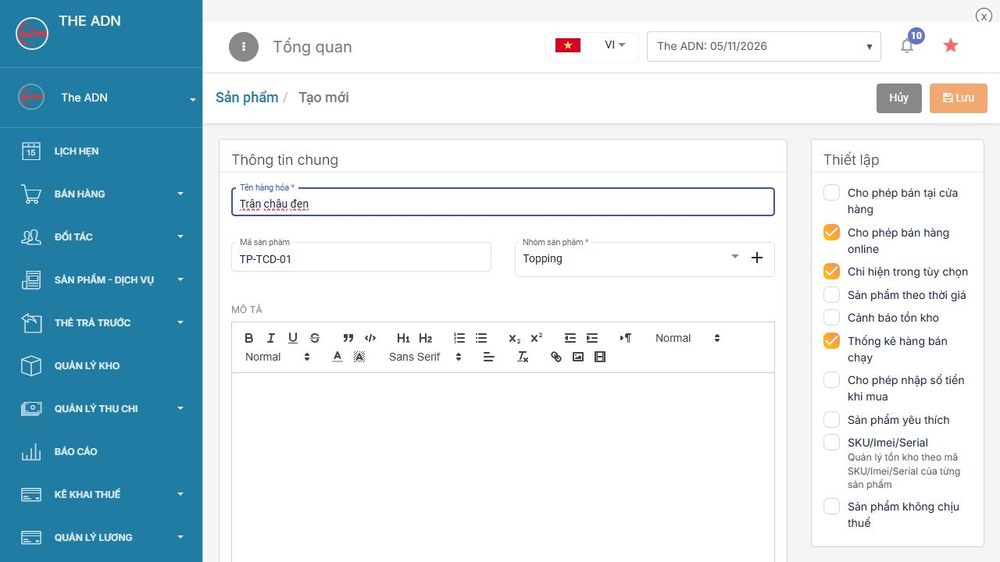
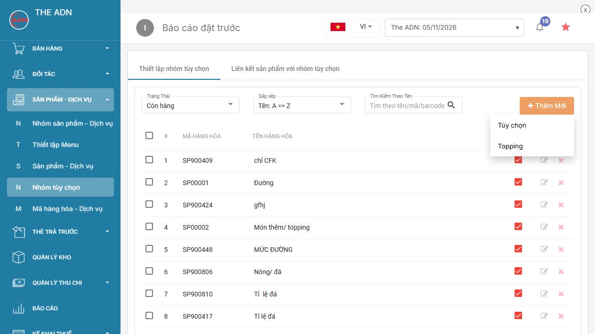
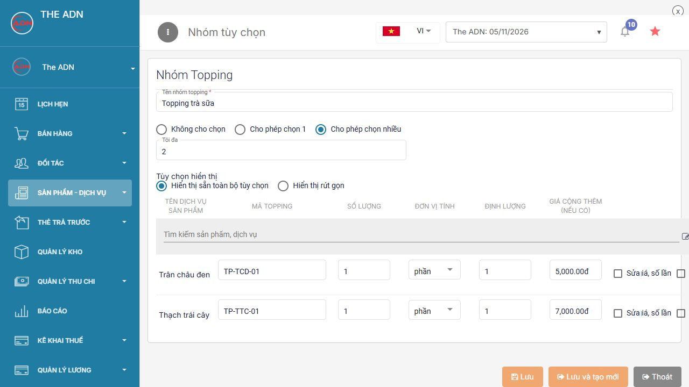
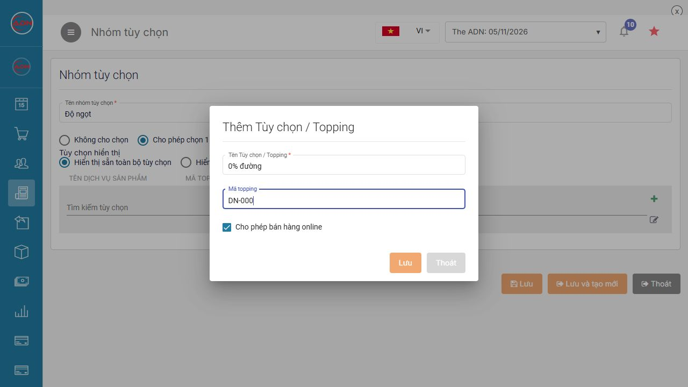
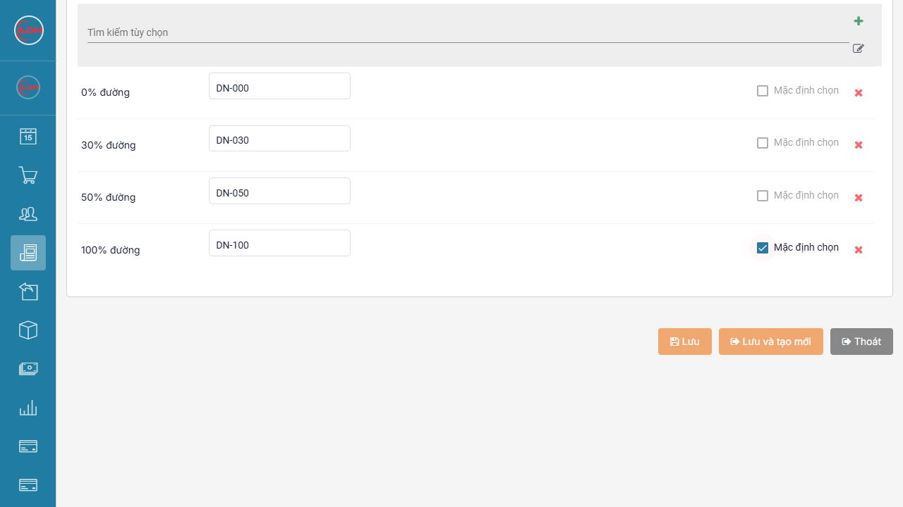
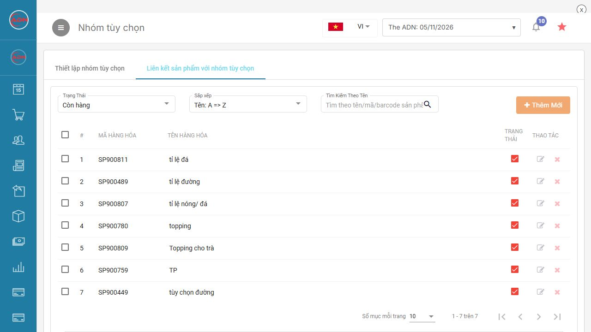
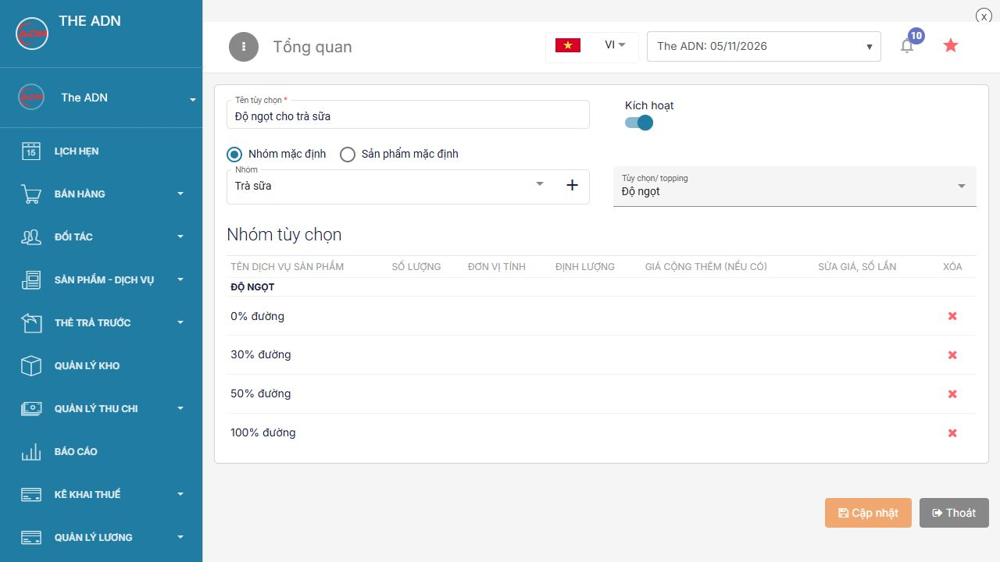
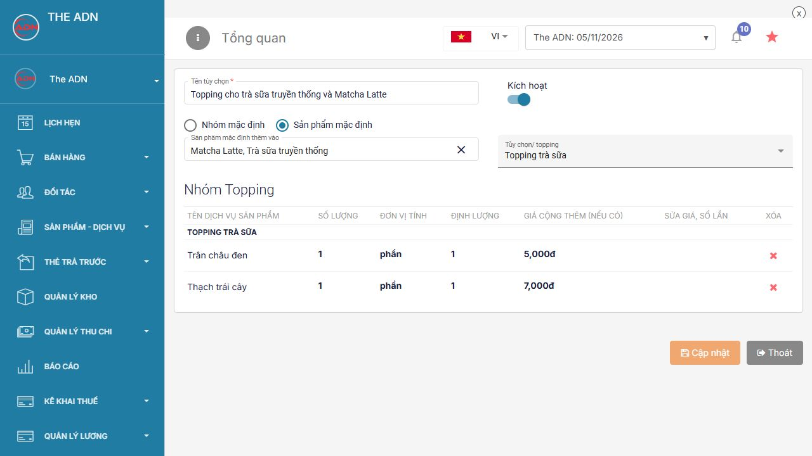

# Tạo tùy chọn topping và liên kết món

Ví dụ hoàn chỉnh: **Trà sữa truyền thống 30.000 đ/ly** và **Matcha Latte 35.000 đ/ly** cùng thuộc nhóm **Trà sữa**. Các món được chọn mức đường; riêng hai món này được thêm **Trân châu đen 5.000 đ/phần** và **Thạch trái cây 7.000 đ/phần**.

## 1. Chuẩn bị món và topping

Tại **Sản phẩm - Dịch vụ → Sản phẩm - Dịch vụ**, tạo và lưu các sản phẩm theo bảng. Nếu đã có đúng tên và mã, dùng lại sản phẩm đó.

| Tên | Mã | Nhóm sản phẩm | Đơn vị | Giá bán |
| --- | --- | --- | --- | --- |
| Trà sữa truyền thống | TS-TT-01 | Trà sữa | ly | 30.000 đ |
| Matcha Latte | HD-MATCHA-01 | Trà sữa | ly | 35.000 đ |
| Trân châu đen | TP-TCD-01 | Topping | phần | 5.000 đ |
| Thạch trái cây | TP-TTC-01 | Topping | phần | 7.000 đ |

Với hai topping trong ví dụ:

1. Tạo như một sản phẩm thông thường; chọn nhóm **Topping**.
2. Tắt **Cho phép bán tại cửa hàng** nếu không bán topping thành món riêng.
3. Bật **Cho phép bán hàng online** nếu topping được dùng trên kênh online, đồng thời bật **Chỉ hiện trong tùy chọn** để không hiện như món online độc lập.
4. Chọn đơn vị **phần**, tỷ lệ **1**, nhập giá rồi **Lưu**.
5. Trong ví dụ chưa theo dõi tồn của topping. Nếu cần theo dõi tồn hoặc định lượng, chọn cấu hình phù hợp tại [Thêm sản phẩm trên web](../huong-dan-them-san-pham-thu-cong/them-sp-web.md).

<figure><figcaption>
Topping được tạo thành sản phẩm trước khi gom nhóm
</figcaption></figure>

## 2. Phân biệt kiểu chọn và lựa chọn sẵn

| Cấu hình | Cách hoạt động | Ví dụ |
| --- | --- | --- |
| Không cho chọn | Các thành phần được dùng cố định, người order không đổi lựa chọn | Một thành phần luôn đi kèm món |
| Cho phép chọn 1 | Chọn một lựa chọn trong nhóm | 0%, 30%, 50% hoặc 100% đường |
| Cho phép chọn nhiều | Chọn nhiều lựa chọn, theo mức Tối đa đã đặt | Chọn tối đa 2 topping |
| Mặc định chọn tại một dòng | Dòng đó được chọn sẵn khi mở món; vẫn tuân theo kiểu chọn của nhóm | 100% đường được chọn sẵn, khách có thể đổi sang 50% trong nhóm Chọn 1 |

**Hiển thị sẵn toàn bộ tùy chọn** mở danh sách để nhân viên thấy ngay. **Hiển thị rút gọn** thu gọn cách trình bày; không thay thế giới hạn chọn 1/chọn nhiều.

## 3. Tạo nhóm Topping trà sữa

1. Chọn **Sản phẩm - Dịch vụ → Nhóm tùy chọn**.
2. Trong **Thiết lập nhóm tùy chọn**, nhấn **Thêm Mới → Topping**.

<figure><figcaption>
Chọn đúng loại nhóm cần tạo
</figcaption></figure>

3. Nhập **Tên nhóm topping = Topping trà sữa**.
4. Chọn **Cho phép chọn nhiều**, nhập **Tối đa = 2**.
5. Chọn **Hiển thị sẵn toàn bộ tùy chọn**.
6. Tại **Tìm kiếm sản phẩm, dịch vụ**, gõ **Trân châu đen** và chọn đúng sản phẩm mã **TP-TCD-01** trong gợi ý.
7. Gõ tiếp **Thạch trái cây**, chọn đúng mã **TP-TTC-01**. Nếu có tên gần giống, đối chiếu mã để tránh chọn nhầm.
8. Kiểm tra hai dòng:

| Topping | Số lượng | Đơn vị | Định lượng | Giá cộng thêm |
| --- | --- | --- | --- | --- |
| Trân châu đen | 1 | phần | 1 | 5.000 đ |
| Thạch trái cây | 1 | phần | 1 | 7.000 đ |

9. Giữ **Mặc định chọn** ở trạng thái không tích để khách tự chọn thêm. Giữ **Sửa giá, số lần** tắt nếu dùng mức giá cố định.
10. Nhấn **Lưu**. Mở lại nhóm để kiểm tra kiểu chọn, giới hạn và giá cộng thêm.

<figure><figcaption>
Giá cộng thêm được kiểm tra tại từng dòng topping
</figcaption></figure>

Giá cộng thêm là số tiền tính thêm khi khách chọn topping cho món, có thể chỉnh theo chính sách của cửa hàng; topping miễn phí đặt giá cộng thêm bằng **0**.

## 4. Tạo ghi chú và nhóm Độ ngọt

Ghi chú được tạo trong Danh mục ghi chú, không phải tạo món bán hàng và không có giá cộng thêm trong ví dụ.

1. Tại **Thiết lập nhóm tùy chọn**, nhấn **Thêm Mới → Tùy chọn**.
2. Nhập **Tên nhóm tùy chọn = Độ ngọt**.
3. Chọn **Cho phép chọn 1**, giữ **Hiển thị sẵn toàn bộ tùy chọn**.
4. Nhấn dấu **+** cạnh ô **Tìm kiếm tùy chọn** để mở **Thêm Tùy chọn / Topping**.
5. Nhập **Tên = 0% đường**, **Mã topping = DN-000**, chọn cho phép online nếu sử dụng rồi nhấn **Lưu** trong hộp này.

<figure><figcaption>
Tạo một mục ghi chú trong danh mục
</figcaption></figure>

6. Tạo tiếp các mức còn lại:

| Ghi chú | Mã |
| --- | --- |
| 30% đường | DN-030 |
| 50% đường | DN-050 |
| 100% đường | DN-100 |

7. Các mục mới được đưa vào bảng của nhóm. Với ghi chú đã có, gõ tên ở **Tìm kiếm tùy chọn** và chọn trong gợi ý để đưa vào nhóm.
8. Tích **Mặc định chọn** tại dòng **100% đường**; chỉ chọn sẵn một dòng cho nhóm Chọn 1.
9. Nhấn **Lưu** ở cuối trang để lưu **nhóm Độ ngọt**. Lưu từng ghi chú trong hộp chưa thay thế bước lưu nhóm.

<figure><figcaption>
Gom ghi chú và đặt một mức đường chọn sẵn
</figcaption></figure>

Biểu tượng **bút chì** cạnh ô tìm kiếm mở danh mục ghi chú để quản lý các mục đã tạo. Không dùng xóa ghi chú chung chỉ để bỏ ghi chú khỏi một nhóm; kiểm tra đúng thao tác tại dòng của nhóm.

## 5. Liên kết Độ ngọt cho cả nhóm Trà sữa

1. Chọn **Liên kết sản phẩm với nhóm tùy chọn** trên thanh đầu trang, nhấn **Thêm Mới**.

<figure><figcaption>
Mở phần thiết lập phạm vi áp dụng
</figcaption></figure>

2. Nhập **Tên tùy chọn = Độ ngọt cho trà sữa** và giữ **Kích hoạt** bật.
3. Chọn **Nhóm mặc định**. Trong biểu mẫu này, lựa chọn đó có nghĩa áp dụng theo **nhóm sản phẩm**.
4. Tại **Nhóm**, chọn **Trà sữa**.
5. Tại **Tùy chọn/ topping**, tích **Độ ngọt** rồi nhấn ra ngoài danh sách.
6. Kiểm tra bảng bên dưới có đủ **0%, 30%, 50%, 100% đường**, nhấn **Lưu**.

<figure><figcaption>
Cả nhóm Trà sữa dùng chung lựa chọn Độ ngọt
</figcaption></figure>

Các món thuộc nhóm **Trà sữa**, gồm Trà sữa truyền thống và Matcha Latte, được dùng nhóm Độ ngọt. Món thuộc nhóm khác không nằm trong liên kết này.

## 6. Liên kết topping cho hai món cụ thể

1. Tạo một liên kết mới, nhập tên **Topping cho trà sữa truyền thống và Matcha Latte**, bật **Kích hoạt**.
2. Chọn **Sản phẩm mặc định**. Trong biểu mẫu này, lựa chọn đó có nghĩa áp dụng theo **từng sản phẩm được chọn**.
3. Mở **Sản phẩm mặc định thêm vào**, tìm và tích **Trà sữa truyền thống** cùng **Matcha Latte**. Nhấn ra ngoài để đóng danh sách.
4. Tại **Tùy chọn/ topping**, tích **Topping trà sữa**, đóng danh sách và đợi bảng thành phần xuất hiện.
5. Kiểm tra **Trân châu đen – 5.000 đ**, **Thạch trái cây – 7.000 đ**, nhấn **Lưu**.

<figure><figcaption>
Áp dụng topping cho đúng các món được tích chọn
</figcaption></figure>

Hai chữ **mặc định** ở phần phạm vi áp dụng không phải ô **Mặc định chọn** của topping/ghi chú. Phạm vi quyết định món nào có tùy chọn; ô Mặc định chọn quyết định lựa chọn nào được chọn sẵn.

## 7. Kiểm tra sau khi lưu

1. Tìm lại từng liên kết bằng tên, nhấn **bút chì** để kiểm tra trạng thái Kích hoạt, phạm vi và nhóm tùy chọn đã lưu.
2. Trên thiết bị thu ngân, đồng bộ dữ liệu. Mở một đơn mới để kiểm tra món; chưa cần thanh toán.
3. Chọn **Trà sữa truyền thống**: nhóm Độ ngọt có bốn mức, chọn một; nhóm topping có Trân châu đen và Thạch trái cây, tối đa hai lựa chọn.
4. Đối chiếu số tiền với một ly:

| Lựa chọn | Thành tiền mẫu |
| --- | --- |
| Trà sữa truyền thống, 50% đường, không topping | 30.000 đ |
| Trà sữa truyền thống + Trân châu đen | 35.000 đ |
| Trà sữa truyền thống + cả hai topping | 42.000 đ |
| Matcha Latte + Trân châu đen | 40.000 đ |

Ghi chú mức đường không cộng tiền. Các số tiền trên chưa tính khoản thuế, phụ thu hoặc khuyến mãi riêng của cửa hàng.

## 8. Khi tùy chọn chưa hiển thị đúng

| Tình huống | Kiểm tra |
| --- | --- |
| Tìm không thấy topping | Sản phẩm topping đã được tạo và lưu; đối chiếu đúng tên/mã |
| Có nhóm nhưng món chưa có tùy chọn | Đã tạo liên kết, bật Kích hoạt và chọn đúng phạm vi |
| Một số món trong nhóm thiếu Độ ngọt | Các món đó có thuộc đúng nhóm Trà sữa không |
| Topping hiện ở món không mong muốn | Kiểm tra liên kết theo nhóm hay từng sản phẩm, các liên kết khác đang cùng áp dụng |
| Chọn thêm bị sai giá | Kiểm tra Giá cộng thêm ở nhóm và bảng liên kết; phân biệt giá món gốc với giá topping |
| Nhân viên chọn nhiều mức đường | Nhóm Độ ngọt phải là Cho phép chọn 1 |
| Dữ liệu trên thu ngân chưa đổi | Đồng bộ dữ liệu rồi mở lại món trong đơn mới |
