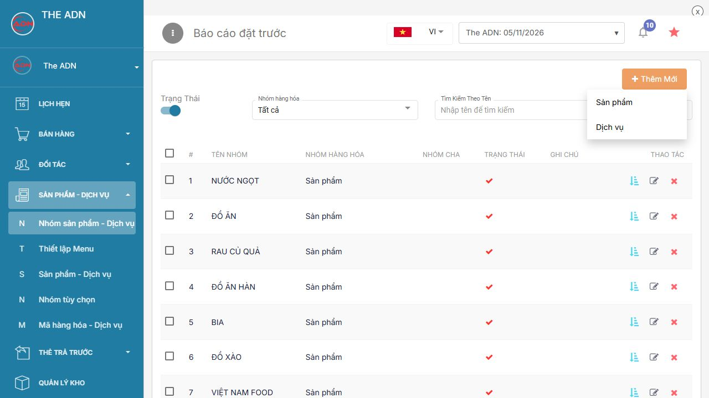
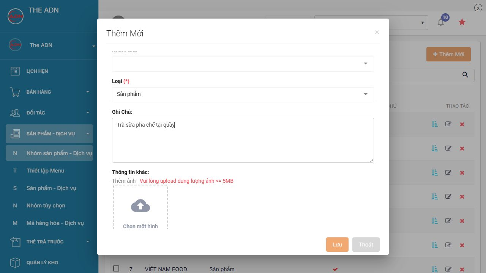
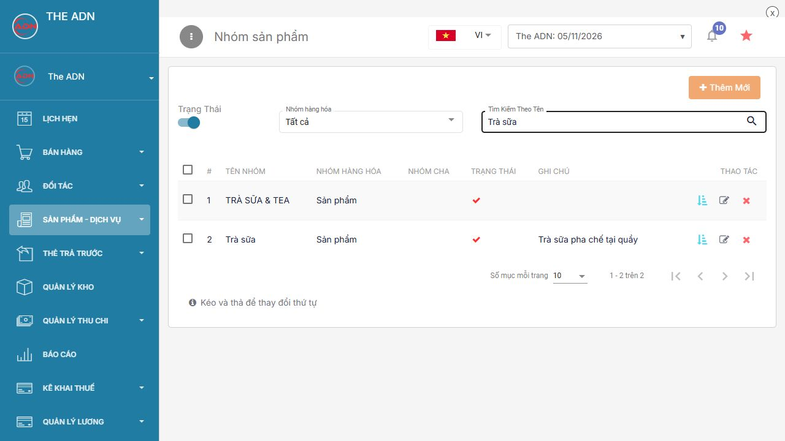
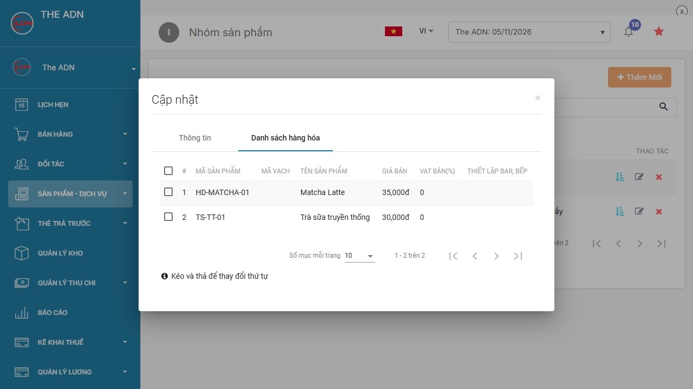
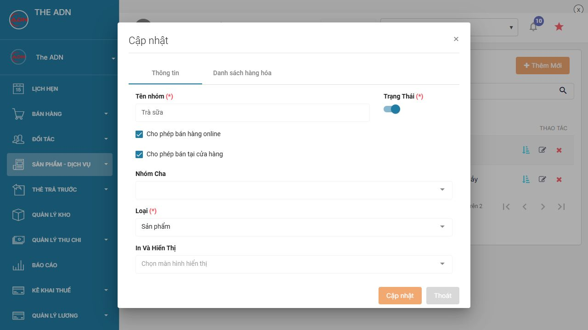

# Quản lý nhóm sản phẩm

Nhóm sản phẩm dùng để gom các món cùng loại trên danh mục và menu bán hàng. Ví dụ, nhóm **Trà sữa** chứa **Trà sữa truyền thống** và **Matcha Latte**. Nhóm này cũng có thể được dùng làm phạm vi áp dụng chung cho tùy chọn Độ ngọt.

## 1. Mẫu nhóm cần tạo

| Thông tin | Giá trị |
| --- | --- |
| Tên nhóm | Trà sữa |
| Loại | Sản phẩm |
| Trạng thái | Bật |
| Cho phép bán tại cửa hàng | Bật |
| Cho phép bán hàng online | Bật nếu bán nhóm này trên kênh online |
| Nhóm cha | Để trống khi tạo nhóm độc lập |
| Ghi chú | Trà sữa pha chế tại quầy |

## 2. Tạo nhóm trên web

1. Đăng nhập [admin.posapp.vn](https://admin.posapp.vn/).
2. Chọn **Sản phẩm - Dịch vụ → Nhóm sản phẩm - Dịch vụ**.
3. Tìm tên nhóm để kiểm tra đã có chưa. Nếu đã có đúng nhóm **Trà sữa**, dùng nhóm đó.
4. Nếu chưa có, nhấn **Thêm Mới → Sản phẩm**.

<figure><figcaption>
Mở biểu mẫu tạo nhóm
</figcaption></figure>

5. Trong tab **Thông tin**, nhập **Tên nhóm = Trà sữa**.
6. Bật **Trạng Thái** để sử dụng nhóm. Chọn kênh bán tại cửa hàng và online theo bảng mẫu.
7. Để trống **Nhóm cha**. Nếu muốn nhóm con, chọn nhóm cha đã tạo trước đó.
8. Kiểm tra **Loại = Sản phẩm**, nhập ghi chú rồi nhấn **Lưu**.

<figure><figcaption>
Thông tin nhóm Trà sữa
</figcaption></figure>

**Loại nhóm:** chọn **Sản phẩm** cho đồ ăn, đồ uống, hàng hóa; chọn **Dịch vụ** khi tạo nhóm cho dịch vụ trong phân hệ tương ứng. Không đổi loại chỉ để thay đổi nơi bán.

## 3. Đưa món vào nhóm

Tạo hoặc mở chỉnh sửa từng sản phẩm:

1. Chọn **Sản phẩm - Dịch vụ → Sản phẩm - Dịch vụ**.
2. Tạo **Trà sữa truyền thống**, mã **TS-TT-01**, đơn vị **ly**, giá **30.000 đ**; chọn **Nhóm sản phẩm = Trà sữa** rồi lưu.
3. Tạo **Matcha Latte**, mã **HD-MATCHA-01**, đơn vị **ly**, giá **35.000 đ**; cũng chọn nhóm **Trà sữa** rồi lưu.

Thao tác nhập đầy đủ thông tin và giá có tại [Thêm sản phẩm trên web](huong-dan-them-san-pham-thu-cong/them-sp-web.md) hoặc [Thêm sản phẩm trên app](huong-dan-them-san-pham-thu-cong/them-sp-fnb.md).

**Lưu nhóm chưa tạo sản phẩm.** Phải chọn nhóm trong từng món và lưu món thì món mới thuộc nhóm đó.

## 4. Kiểm tra nhóm và thành viên

1. Trở lại **Nhóm sản phẩm - Dịch vụ**.
2. Nhập **Trà sữa** vào ô **Tìm Kiếm Theo Tên**, nhấn **kính lúp**.
3. Kiểm tra tên, loại và dấu trạng thái trong danh sách.

<figure><figcaption>
Tìm lại nhóm vừa tạo
</figcaption></figure>

4. Nhấn **bút chì** ở dòng **Trà sữa**, mở tab **Danh sách hàng hóa**.
5. Kiểm tra có **Trà sữa truyền thống – 30.000 đ** và **Matcha Latte – 35.000 đ**.

<figure><figcaption>
Đối chiếu các món đã gán vào nhóm
</figcaption></figure>

Nếu thiếu món, mở lại món đó để kiểm tra **Nhóm sản phẩm**, lưu rồi tải lại danh sách.

## 5. Chỉnh sửa nhóm

1. Nhấn **bút chì** ở dòng nhóm cần sửa.
2. Trong tab **Thông tin**, sửa tên, nhóm cha, ghi chú hoặc kênh bán.
3. Nếu dùng máy in bếp/bar, chọn vị trí tại **In và hiển thị** theo cấu hình máy bán hàng của cửa hàng.
4. Nhấn **Cập nhật**. Đồng bộ dữ liệu trên thiết bị thu ngân để kiểm tra menu mới.

<figure><figcaption>
Các thiết lập khi chỉnh sửa nhóm
</figcaption></figure>

Ví dụ, đổi ghi chú của nhóm **Trà sữa** thành **Pha chế tại quầy bar** rồi nhấn **Cập nhật**. Tên và nhóm của các món vẫn được kiểm tra tại tab **Danh sách hàng hóa**.

## 6. Tạm ngừng dùng và xóa nhóm

Muốn tạm ngừng dùng nhóm, mở **Thông tin**, tắt **Trạng Thái** rồi **Cập nhật**. Muốn chỉ ngừng bán một món, làm theo [Bật tắt sản phẩm](khac/bat-tat-mon-tai-cua-hang-web-app.md).

Chỉ xóa khi nhóm không còn dùng: kiểm tra **Danh sách hàng hóa**, chuyển các món sang nhóm phù hợp, trở lại danh sách nhóm rồi nhấn biểu tượng **X** đúng dòng và đọc thông báo xác nhận. Không dùng xóa nhóm để báo một món tạm hết hàng.
