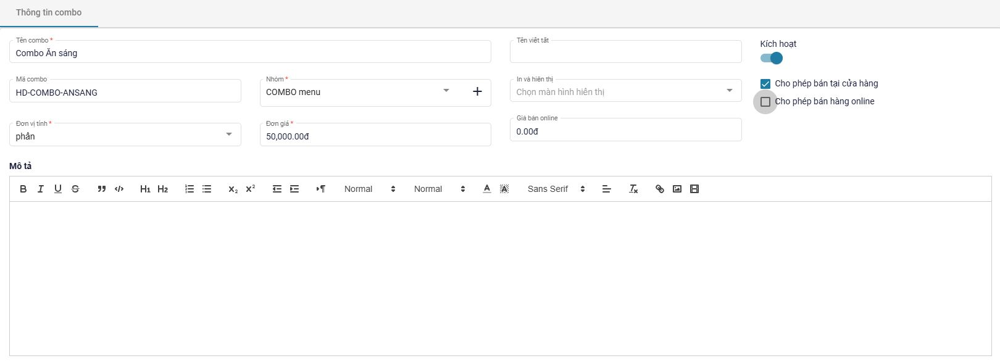
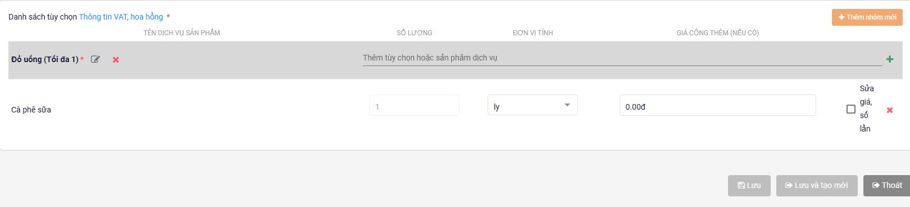
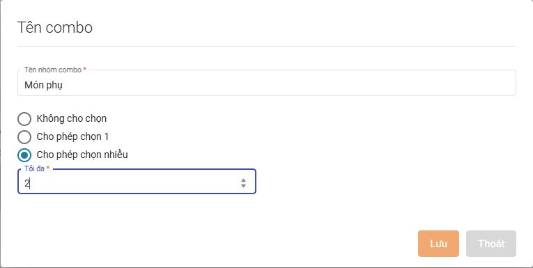

# Tạo combo

Combo là một sản phẩm gồm nhiều món được bán chung với **giá riêng**. Một combo có thể có món cố định, nhóm chỉ chọn một món và nhóm cho phép chọn nhiều món.

Ví dụ xuyên suốt: **Combo Ăn sáng giá 50.000đ**, gồm **1 Bánh mì** cố định và **1 đồ uống** được chọn giữa Cà phê sữa hoặc Nước ép. Chọn Cà phê sữa không cộng thêm; chọn Nước ép cộng thêm 5.000đ. Các tên món và giá trong bài là ví dụ, thay bằng dữ liệu của cửa hàng khi thực hiện.

## 1. Chuẩn bị trước khi tạo combo

1. Truy cập [admin.posapp.vn](https://admin.posapp.vn/) và đăng nhập bằng tài khoản có quyền quản lý sản phẩm.
2. Kiểm tra các món sẽ đưa vào combo đã có trong hệ thống. Với ví dụ này, cần có **Bánh mì**, **Cà phê sữa**, **Nước ép**.
3. Nếu chưa có món, vào **Sản phẩm - Dịch vụ → Sản phẩm - Dịch vụ → Thêm Mới → Sản phẩm**. Nhập thông tin, nhóm, đơn vị tính và giá bán lẻ của món rồi lưu. Xem chi tiết tại [Thêm sản phẩm trên web](huong-dan-them-san-pham-thu-cong/them-sp-web.md).
4. Chuẩn bị nhóm sản phẩm dùng để chứa combo, chẳng hạn **Combo** hoặc **COMBO menu**. Có thể dùng nhóm đã có; nếu cần nhóm mới, tạo tại **Sản phẩm - Dịch vụ → Nhóm sản phẩm - Dịch vụ** theo [Quản lý nhóm sản phẩm](quan-ly-nhom-san-pham.md).


Món phải được tạo và lưu thành sản phẩm trước thì mới tìm và gán được vào combo. Giá bán lẻ của món và giá cộng thêm khi chọn món trong combo là hai thông tin khác nhau; không cần đổi giá bán lẻ của món về 0 để đưa vào combo.


**Phân biệt hai loại nhóm:**

| Loại nhóm | Dùng để làm gì? | Ví dụ |
| --- | --- | --- |
| Nhóm sản phẩm | Phân loại và chứa sản phẩm combo trong danh sách/menu | Combo, COMBO menu |
| Nhóm tùy chọn bên trong combo | Quy định món nào đi kèm và khách được chọn như thế nào | Món chính, Đồ uống, Món phụ |

## 2. Mở màn hình tạo combo

1. Trong menu bên trái, mở **Sản phẩm - Dịch vụ**.
2. Chọn tiếp **Sản phẩm - Dịch vụ** để vào danh sách hàng hóa.
3. Nhấn **Thêm Mới** ở góc trên bên phải.
4. Chọn **Combo**. Màn hình **Thông tin combo** xuất hiện.

## 3. Khai báo thông tin và giá bán combo

Điền phần thông tin phía trên trước, sau đó mới tạo danh sách món bên trong.

| Trường | Cách nhập | Giá trị mẫu |
| --- | --- | --- |
| Tên combo | Đặt tên dễ nhận biết trên menu bán hàng | Combo Ăn sáng |
| Mã combo | Nhập mã riêng, tránh trùng mã đã dùng | HD-COMBO-ANSANG |
| Nhóm | Chọn nhóm sản phẩm chứa combo | COMBO menu |
| Đơn vị tính | Chọn đơn vị bán cho toàn bộ combo | phần |
| Đơn giá | Nhập giá cơ bản của một combo tại cửa hàng | 50.000đ |
| Kích hoạt | Bật để sử dụng combo | Bật |
| Cho phép bán tại cửa hàng | Tích nếu bán trên menu tại cửa hàng | Tích |
| Cho phép bán hàng online | Tích khi cần sử dụng kênh online | Bỏ tích nếu chỉ bán tại cửa hàng |
| Giá bán online | Kiểm tra và nhập giá phù hợp nếu bật bán online | Theo giá của cửa hàng |
| In và hiển thị | Chọn vị trí máy in/hiển thị phù hợp với cách vận hành | Theo cấu hình bếp/bar |

Có thể bổ sung **Tên viết tắt**, **Mô tả** và hình ảnh để nhân viên nhận biết combo.

<figure><figcaption>
Thông tin và giá bán cơ bản của combo
</figcaption></figure>


Đơn giá 50.000đ là giá bán của cả combo. Không lấy tổng giá bán lẻ các món để thay cho giá combo, và không nhập lại toàn bộ giá món vào cột Giá cộng thêm.


## 4. Hiểu ba kiểu nhóm lựa chọn

Tại **Danh sách tùy chọn**, mỗi nhóm có một cách chọn riêng:

| Kiểu trên màn hình | Khi bán combo | Ví dụ |
| --- | --- | --- |
| Không cho chọn | Các món trong nhóm đi kèm cố định; người bán/khách không đổi lựa chọn trong nhóm này | Luôn có 1 Bánh mì |
| Cho phép chọn 1 | Chọn một món trong các món thuộc nhóm | Chọn Cà phê sữa hoặc Nước ép |
| Cho phép chọn nhiều | Có thể chọn nhiều món, trong giới hạn Tối đa đã cấu hình | Chọn tối đa 2 món phụ trong danh sách 5 món |

**“Không cho chọn” chính là nhóm mặc định, cố định** được nhắc đến trong các ví dụ. Một combo có thể kết hợp cả ba kiểu nhóm; không bắt buộc tất cả các món dùng chung một kiểu.

## 5. Tạo nhóm món cố định

Với Combo Ăn sáng, tạo nhóm chứa Bánh mì:

1. Kéo xuống **Danh sách tùy chọn**, nhấn **Thêm nhóm mới**.
2. Trong hộp thoại, nhập **Tên nhóm combo** là **Món chính**.
3. Chọn **Không cho chọn**.
4. Nhấn **Lưu** trong hộp thoại để xác nhận nhóm.
5. Ở dòng nhóm **Món chính**, nhập tên **Bánh mì** vào ô **Thêm tùy chọn hoặc sản phẩm dịch vụ**.
6. Nhấn đúng sản phẩm trong danh sách gợi ý để đưa món vào nhóm.
7. Kiểm tra **Số lượng**, **Đơn vị tính**, **Giá cộng thêm (nếu có)** của món. Ví dụ: **1 cái**, giá cộng thêm **0đ**.

Kết quả mong muốn: khi bán Combo Ăn sáng, Bánh mì được chọn cố định.


Nút Lưu trong hộp thoại chỉ xác nhận cấu hình nhóm. Sau khi hoàn thành toàn bộ thông tin và các món, cần nhấn Lưu của biểu mẫu combo ở cuối trang.


## 6. Tạo nhóm đồ uống cho phép chọn một

1. Nhấn **Thêm nhóm mới**.
2. Nhập **Tên nhóm combo** là **Đồ uống**.
3. Chọn **Cho phép chọn 1**, nhấn **Lưu** trong hộp thoại.
4. Tại dòng nhóm **Đồ uống**, nhập **Cà phê sữa** vào ô tìm kiếm, nhấn chọn món trong gợi ý.
5. Tiếp tục tìm và chọn **Nước ép** tại chính nhóm này.
6. Kiểm tra đơn vị và nhập **Giá cộng thêm (nếu có)** cho từng món:

| Món trong nhóm Đồ uống | Đơn vị mẫu | Giá cộng thêm |
| --- | --- | --- |
| Cà phê sữa | ly | 0đ |
| Nước ép | ly | 5.000đ |

<figure><figcaption>
Tìm món trong nhóm và khai báo giá cộng thêm tại từng dòng
</figcaption></figure>

Ảnh minh họa thời điểm đã thêm Cà phê sữa; tiếp tục thêm Nước ép để hoàn thành nhóm trong ví dụ.

**Cách tính giá của ví dụ:**

| Khách chọn | Giá cơ bản | Phần cộng thêm | Giá combo sau lựa chọn |
| --- | --- | --- | --- |
| Bánh mì + Cà phê sữa | 50.000đ | 0đ | 50.000đ |
| Bánh mì + Nước ép | 50.000đ | 5.000đ | 55.000đ |

Với mỗi combo trong ví dụ, giá sau lựa chọn bằng **giá cơ bản của combo + giá cộng thêm của món đã chọn**. Các giá trên chưa xét khuyến mãi, phụ thu hoặc thuế riêng của hóa đơn.

## 7. Thêm nhóm cho phép chọn nhiều khi cần

Nếu combo còn có phần món phụ:

1. Nhấn **Thêm nhóm mới**.
2. Nhập tên nhóm, ví dụ **Món phụ**.
3. Chọn **Cho phép chọn nhiều**.
4. Nhập **Tối đa**, ví dụ **2** để giới hạn chọn tối đa hai lựa chọn trong nhóm.
5. Nhấn **Lưu** trong hộp thoại.
6. Tìm và thêm từng sản phẩm món phụ vào nhóm.
7. Kiểm tra đơn vị và giá cộng thêm của từng món.

<figure><figcaption>
Nhóm Món phụ cho phép chọn nhiều, tối đa 2 lựa chọn
</figcaption></figure>


Tối đa 2 là giới hạn tối đa, không phải chỉ dẫn bắt buộc khách phải chọn đủ 2 món. Phân biệt số lựa chọn của cả nhóm với số lượng và đơn vị của từng sản phẩm trong nhóm.


Nếu cửa hàng chỉ bán combo Bánh mì + một đồ uống thì không cần tạo thêm nhóm Món phụ.

## 8. Kiểm tra và lưu combo

Trước khi lưu, đối chiếu cấu hình của Combo Ăn sáng:

- **Thông tin chung:** đúng tên, nhóm, đơn vị phần và đơn giá 50.000đ.
- **Kênh bán:** đã Kích hoạt và tích Cho phép bán tại cửa hàng; kiểm tra riêng giá/kênh online nếu sử dụng.
- **Món chính:** Không cho chọn, có Bánh mì, đúng số lượng và đơn vị.
- **Đồ uống:** Cho phép chọn 1, có Cà phê sữa và Nước ép.
- **Giá cộng thêm:** Cà phê sữa 0đ, Nước ép 5.000đ.
- **In và hiển thị:** đúng cấu hình của cửa hàng.

Sau đó:

1. Nhấn **Lưu** ở cuối biểu mẫu combo. Dùng **Lưu và tạo mới** nếu muốn lưu xong rồi nhập combo tiếp theo.
2. Quay lại danh sách **Sản phẩm - Dịch vụ**, tìm theo tên hoặc mã combo.
3. Nhấn biểu tượng **bút chì** ở dòng combo để mở lại, kiểm tra các nhóm, món và giá đã lưu.

**Sửa trong lúc cấu hình:** biểu tượng bút chì cạnh tên nhóm dùng để sửa nhóm; dấu × ở dòng món dùng để bỏ món khỏi combo. Kiểm tra đúng dòng trước khi thao tác và lưu lại combo sau khi chỉnh sửa.

## 9. Đồng bộ và kiểm tra khi bán hàng

1. Đồng bộ dữ liệu trên thiết bị/ứng dụng thu ngân sau khi lưu combo trên web.
2. Tìm và chọn **Combo Ăn sáng** trên menu bán hàng.
3. Kiểm tra Bánh mì là món cố định.
4. Thử chọn Cà phê sữa: giá combo cần hiển thị **50.000đ**.
5. Đổi sang Nước ép: giá combo cần hiển thị **55.000đ**; nhóm đồ uống chỉ chọn được một món tại một thời điểm.
6. Nếu có nhóm chọn nhiều, kiểm tra giới hạn Tối đa đã đặt.
7. Kiểm tra chi tiết món gửi bếp/bar theo cấu hình in và hiển thị.

Thực hiện kiểm tra lựa chọn và giá trước khi dùng combo để bán thực tế.

## 10. Các vướng mắc thường gặp

| Vướng mắc | Cách kiểm tra và xử lý |
| --- | --- |
| Không tìm được món để thêm vào combo | Tạo và lưu món dưới dạng sản phẩm trước; kiểm tra lại tên món khi tìm kiếm |
| Có nhóm nhưng chưa có món bên trong | Nhập tên vào ô Thêm tùy chọn hoặc sản phẩm dịch vụ và nhấn món trong danh sách gợi ý; chỉ nhập chữ chưa phải đã gán món |
| Khách không đổi được đồ uống | Kiểm tra nhóm Đồ uống có đang để Không cho chọn; đổi thành Cho phép chọn 1 rồi lưu và đồng bộ |
| Muốn chọn nhiều nhưng chỉ chọn được một | Kiểm tra kiểu nhóm và ô Tối đa; chuyển sang Cho phép chọn nhiều với giới hạn phù hợp |
| Giá combo cao hơn dự kiến | Kiểm tra Đơn giá của combo và Giá cộng thêm tại từng món đã chọn; tránh nhập lại giá bán lẻ vào giá cộng thêm |
| Chọn Nước ép nhưng chưa cộng 5.000đ | Mở lại combo, kiểm tra đúng dòng Nước ép có giá cộng thêm 5.000đ, lưu và đồng bộ lại |
| Nút Lưu chưa sử dụng được hoặc lưu báo lỗi | Kiểm tra các trường có dấu *, nhất là tên, nhóm, đơn vị, đơn giá và danh sách tùy chọn; xử lý các thông báo lỗi trên biểu mẫu |
| Combo chưa thấy trên menu | Kiểm tra Kích hoạt, Cho phép bán tại cửa hàng và dữ liệu đã đồng bộ trên thu ngân |
| Combo không xuất hiện trên kênh online | Kiểm tra Cho phép bán hàng online, Giá bán online và cấu hình kênh đang dùng |
| Món gửi sai máy in/bếp | Kiểm tra In và hiển thị và máy in được cài trên thiết bị bán hàng |

## 11. Phân biệt combo với topping và ghi chú

- **Combo:** gom nhiều món thành một sản phẩm bán chung, có giá cơ bản riêng và có thể thêm tiền theo lựa chọn.
- **Topping:** tùy chọn gắn với món/nhóm món, lấy từ các sản phẩm đã tạo; có thể có hoặc không có giá.
- **Ghi chú:** các lựa chọn như ít đá, 50% đường, không hành; được quản lý tại Danh mục Ghi chú và mặc định không có giá.

Xem [Tạo tùy chọn/topping và liên kết món](nhom-tuy-chon-dich-vu/tao-tuy-chon-topping-va-lien-ket-mon.md) khi cần thiết lập topping hoặc ghi chú cho sản phẩm.
