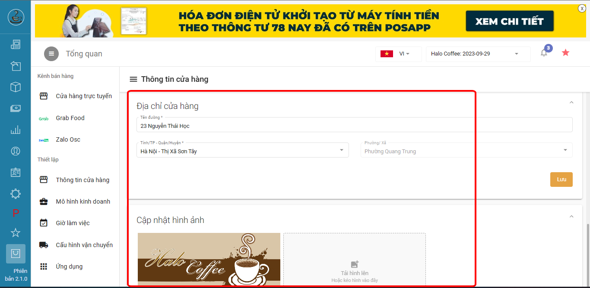
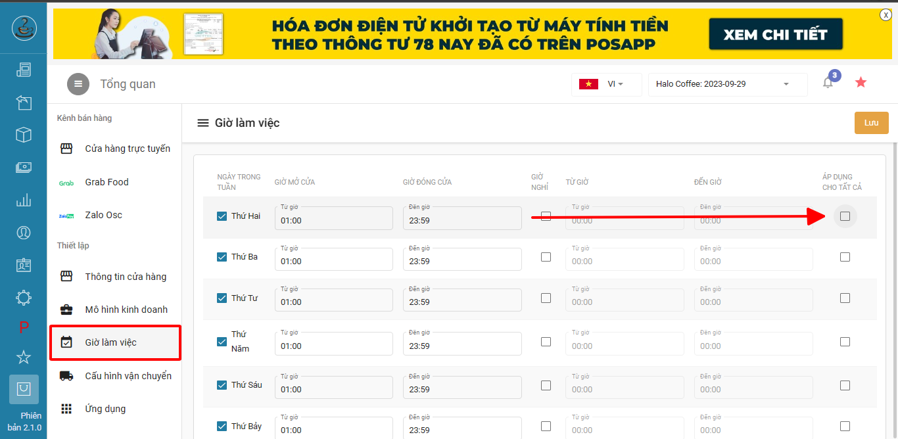
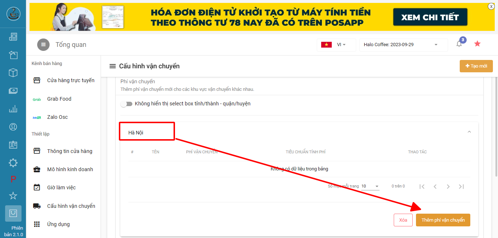
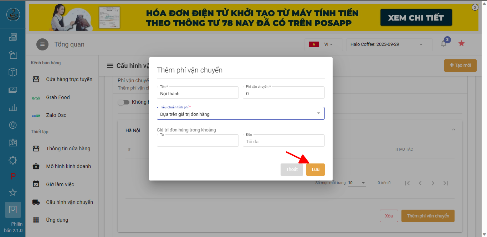
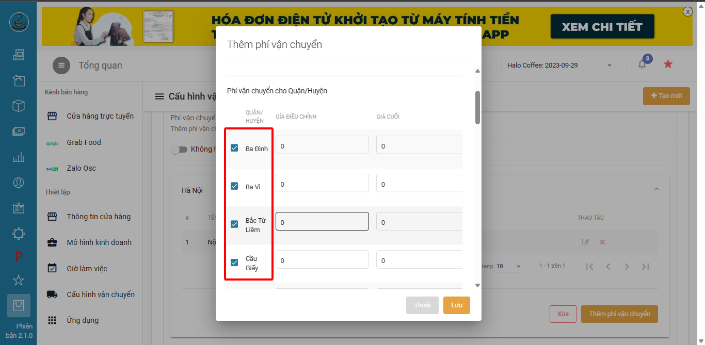

# Setup web order

**HƯỚNG DẪN SETUP WEB ORDER**\
_(Là trang web order do PosApp cung cấp cho chủ quán)_

### A. Demo

\- Hình ảnh web

.png>)

\- Video thao tác order của khách hàng



### B. Hướng dẫn setup

### 1. Thiết lập cửa hàng trực tuyến

Truy cập trang quản trị > Đặt hàng online > cửa hàng trực tuyến

.png>)

#### a) Địa chỉ trang web

\- Tên miền chính chủ cửa hàng đặt tùy ý và đuôi sẽ có "posapp.vn" (ví dụ trên có tên miền halocoffee.posapp.vn)

\- Tên miền tùy chỉnh là tên miền khi khách mua từ bên ngoài sau đó trỏ tên miền đã mua về địa chỉ trang web của posapp

.png>)

#### b) Top Banner

Kéo xuống dưới để setup banner là nội dung sẽ xuất hiện đầu trang web

.png>)

.png>)

#### c) Hình thức vận chuyển

Cửa hàng lựa chọn hình thức giao hàng mà cửa hàng thấy thuận tiện nhất

\- khách hàng tự đặt mua rồi đến lấy: khách đặt xong tự qua quán lấy đồ\
\- Giao hàng thông qua đơn vị vận chuyển: khách đặt xong sẽ chọn đơn vị vận chuyển để giao hàng (đơn vị heyou, ahamove)\
-Thiết lập khu vực giao và phí vận chuyển: cửa hàng tự tính và setup phí giao, tự đi giao

.png>)

#### d) Phương thức thanh toán Tiền mặt và chuyển khoản (nếu tích ck thì chủ quán ghi thông tin chuyển khoản xuống bên dưới)

.png>)

e) Ghi chú thanh toán\
Là nội dung muốn truyển tài tới khách hàng khi khách thanh toán

.png>)

.png>)

Setup xong xuôi thì lưu lại để áp dụng thay đổi

### 2. Thuết lập thông tin cửa hàng

Vào mục thông tin cửa hàng setup các thông tin sau

#### a) Thông tin chung

bao gồm tên cửa hàng, sđt, và mô tả cửa hàng

.png>)

#### b) Liên hệ cửa hàng

Kéo xuống dưới điền thông tin liên hệ của cửa hàng

.png>)

SĐT: Điền sđt như thông thường

Zalo: https://zalo.me/84337260123 (điền sđt dạng 84xxx sau me/)

Messenger: https://www.messenger.com/t/userid/ (trong đó user ID mà user định danh fb của bạn)

Fanpage: đường link page fb của cửa hàng

c) Địa chỉ cửa hàng + baner

Kéo xuống dưới điền địa chỉ cửa hàng + thêm hình ảnh cửa hàng

bạn sẽ được trang web có baner như sau

.png>)

### 3. Giờ làm việc

Quy định thời gian cho phép khách hàng có thể đặt đơn trên web order

### 4. Cấu hình vận chuyển

#### a) Cửa hàng tự giao

Chọn thêm mới > Chọn khu vực muốn cửa hàng tự giao

.png>)

.png>)

Ấn vào khu vực vừa chọn > thêm phí vận chuyển

Điền tên phí vận chuyển > setup mức tiền hóa đơn tối thiểu khi áp dụng phí vận chuyển này > lưu lại

Tiếp theo ấn vào chỉnh sửa phí vừa thêm

.png>)

Ta sẽ thấy các khu vực quận huyện của tỉnh vừa chọn, không muốn giao ở khu vực nào thì bỏ chọn khu vực đó

Điền giá giao cho từng khu vực quận huyện > lưu lại

.png>)

#### b) Giao hàng thông qua đơn vị vận chuyển

Điền thông tin cửa hàng (cần điền chính xác để đơn vị vận chuyển tính giá chính xác)

<figure><figcaption></figcaption></figure>

Tiếp theo chọn loại hình thức giao phù hợp với sản phẩm mình bán > lưu lại

<figure><figcaption></figcaption></figure>

Như vậy là hoàn thành setup web bán hàng cho quán

Bước cuối cùng là quảng cáo đường link web của mình lên các phương tiện truyền thông để khách hàng biết và đặt hàng

**>> Chúc các bạn thành công**
